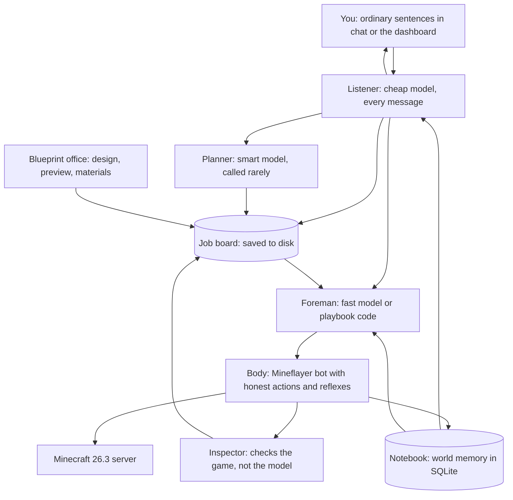

# How We Make It Better

This builds on `01-sota-research.md`. Every design choice below points back to a specific project that failed without it, or succeeded because of it.

---

## The short story

Think of the agent as a small construction company instead of one very smart person.

Today's best agent (Mine AI MCP, the one that beat the dragon) is like one brilliant foreman who does everything himself, talks through every step out loud, and rereads his entire diary before every move. It works, but it's slow, expensive, and it only works with the biggest models. If he crashes, he has to work out from his diary where he was.

We split the work the way a real crew does:

- **The body** is the worker on site. He has good hands (careful actions that report honestly what happened) and good instincts (he eats when hungry and dodges creepers without being told).
- **The job board** is a whiteboard listing every task, what "done" looks like, and who is on it. It's saved to disk, so a crash, a death, or a restart never loses the plan.
- **The listener** is the person at the front desk. You talk in ordinary sentences. He decides whether you asked a question, gave an order, changed your mind, or said yes to something that was waiting.
- **The planner** is the architect. Smart and expensive, so we only call him when we need a new plan or when something has gone badly wrong.
- **The foreman** is fast and cheap. He takes the next job off the board and drives the worker through it, step by step.
- **The notebook** is the site logbook. Where the portal is, what's in each chest, which rooms of the mansion are cleared. The listener, planner, and foreman each get a short extract from it, not the whole history.
- **The inspector** checks every finished job against the game itself. Is the item really in the inventory? Is the wall really there? The model saying "done" never counts.
- **The blueprint office** handles building. It designs with shapes (walls, towers, roofs), shows you a preview, works out exactly what materials are needed, and hands the build to the crew in sections.
- **You** are the client. You talk in ordinary sentences, in game chat or in the dashboard. "Kill the dragon." "How's it going?" "Come here." "Looks good." "Wait, use oak." The listener works out what you meant. There is no command list to learn.

Run like this, a dragon kill becomes a checklist of about 15 jobs, each with a clear finish line. A castle becomes "gather 4,000 stone bricks, then build the north wall layer by layer, then check it against the blueprint." A mansion becomes "find it, gear up, then clear and light each room, marking it on the map."

---

## How the pieces fit

One mission goes like this:

1. You say "kill the ender dragon," or any other wording of the same idea. The listener treats it as a new mission.
2. The planner writes a job tree with a finish line on each job (for example, "3 blaze rods in inventory").
3. The foreman takes the next open job and gets a short briefing: the job, the relevant facts from the notebook, recent events, and which playbooks are available.
4. The foreman runs a tested playbook if one fits. If not, it picks actions one at a time.
5. The body carries them out and returns a receipt for each action, describing what was actually observed.
6. The inspector checks the job's finish line against the game.
7. If it passed, the job is marked done and we move on. If it failed, we retry a different way. After a few failures, the planner is called in to re-plan.

---

## Zoom in: each piece

### 1. The body: honest hands and instincts

**What it is:** A single process connected to Minecraft through Mineflayer. It offers a small, fixed set of actions over MCP (the standard way AI models call tools): look around, walk to, collect, craft, smelt, place, fight, use container, and so on.

**Why:** Mine AI MCP won mostly because of this layer. They forked Mineflayer and its physics engine to fix cases where the bot reported a block placed or an item crafted when it wasn't. Agents built on dishonest actions, like Mindcraft's generated code, fail in ways the model can't notice.

**What we do:**
- **Start from Mine AI MCP's body** (MIT licensed) rather than writing our own. That includes their Mineflayer fixes.
- **Every action returns a receipt:** what we asked for, what was observed, and whether the observation confirmed it. For example: "placed oak_planks at (10, 64, 3): confirmed by block update."
- **Long actions run in the background.** Smelting a stack takes over 10 minutes. The foreman checks progress instead of waiting.
- **Reflexes run without the model:** eat when hungry, fight or flee from hostile mobs, escape fire and lava, surface for air, recover footing. (Mine AI MCP and mc-agents both found this essential.)
- **Protected zones (new).** Mine AI MCP's own limitations doc says the bot will dig through your walls when pathing. We register every blueprint area and every base as a protected zone in the notebook, and the pathfinder treats blocks inside those zones as unbreakable. Mineflayer's pathfinder already supports a "can't break these" list, so this is a small change with a big payoff.
- **Survival-only by design.** The bot is never given operator rights on the real server. It *can't* use `/give`, `/setblock`, or `/tp`, so it can't cheat even by accident. This is enforced by the server, not by a promise in a prompt.
- **Fair sight (new).** The bot receives every block within about 160 blocks, buried ores included, which is x-ray. Paper's anti-xray hides buried ores and chests on the server, and the bot only picks destinations it has a clear line of sight to. A `seek(want)` action runs the look, pick, and move loop in code. Details are in `05-perception-and-exploration.md`.

---

### 2. The job board: a plan that survives anything

**What it is:** A tree of jobs saved in SQLite. Each job has a goal, a finish line the game can confirm, a status (open, active, done, failed, blocked), its attempts, and the evidence collected.

**Why:** No existing agent keeps a durable plan. Mindcraft forgets its mission on restart. Mine AI MCP's plan lives inside the model's conversation. For "build a castle overnight," a crash at 3am has to cost you nothing.

**What we do:**
- **Every job has a "done when" check the game can answer.** "Have 3 blaze_rod." "Standing in the_end." "Blueprint section `north_wall` is at least 98% matched." "Advancement `minecraft:end/kill_dragon` granted."
- **Restart means resume.** On startup, the brain reads the board, re-checks the active job's finish line, and continues.
- **Deaths become jobs.** When the bot dies, the reflex logs where it happened, and the board gets a "go back and pick up dropped items within 5 minutes" job ahead of everything else.
- **Retry with a reason.** A failed job records why it failed. The next attempt has to try something different (another route, another target, gearing up first). After 3 failures, the planner gets involved.
- **Multiple bots later for free.** Bots "claim" jobs from the board. Adding a second worker means letting a second body claim jobs, not rewriting the brain.

---

### 3. Listener, planner, and foreman: three speeds of thinking

**What it is:** Three model roles. The listener is a fast, cheap model that reads everything you say. The planner is a top model (for example Claude Opus 5 or GPT-6 Astra) that writes and repairs the job tree. The foreman is a fast, cheap model, or plain playbook code, that runs one job at a time.

**Why:** You talk in ordinary sentences, and those sentences are not all the same kind of thing. "Kill the dragon" is a mission. "How's it going?" is a question. "Come here" is an order for right now. "Looks good" is a yes to whatever is waiting. "Wait, oak, not birch" is a correction. A fixed list of commands only covers the phrases we wrote down, and you would have to remember them. Astra + Jev killed the dragon with 35 planner calls and 131 small decisions for about $0.97. Mine AI MCP used one huge model for everything at about $93. The listener and the foreman exist so that a sentence, and a moment-to-moment choice, do not each cost a planner call.

**What we do:**
- The listener runs on every message from you, in game chat or the dashboard text box. There is no command syntax, and no special words it is waiting for.
- It sees a small state card, not the whole history: who is speaking, the current mission, the active job, anything waiting for a yes or no, and where the bot is. The notebook and the board supply that card. Follow-ups like "the stone one," "nah," and "actually wait" refer to whatever that card says is in front of you.
- One message can ask for more than one thing. "Come here and tell me how the wall is going" means walk over, and answer.
- A long, rambling request becomes a mission for the planner. It does not become one giant action.
- It routes like this:
  - A new goal, or a real change of goal, goes to the planner.
  - A nudge to work already on the board ("north wall first," "use the oak") goes to the foreman, or a small edit of the board. The planner stays out unless the goal itself changed.
  - A question is answered from the notebook, the board, and the live body. No new jobs.
  - Pause, resume, stop, come here, follow me, and wait go straight to the board and the body.
  - A yes or no while something is waiting ("go ahead," "not yet," "make the towers taller") opens that gate or sends it back. The same words with nothing waiting are ordinary chat, and the listener says what it understood.
- If the listener is not sure, it asks one short question in the same chat. It does not start a mission, enter the End, or approve a build on a guess.
- Only your messages count. The bot ignores its own chat. If other people join later, it acts when the message is clearly aimed at it.
- The planner is called only at the start of a mission, when a job fails 3 times, when you change the goal, or when the listener decides a message is one of those.
- The foreman handles the step-by-step loop.
- **A fresh short briefing for each job.** 88% of Mine AI MCP's cost was the model rereading its own growing history. Instead, every job starts with a briefing of a few thousand tokens built from the notebook and the board. Conversations never grow without limit.
- **Model-neutral.** One small adapter per provider, so we can swap models as better ones come out.

---

### 4. Playbooks: tested routines instead of improvised code

**What it is:** TypeScript routines for things that come up again and again: "get a full set of iron armor from scratch," "build a nether portal with a bucket and lava," "triangulate the stronghold," "destroy end crystals."

**Why:** Voyager showed that saved skills compound over time. Odyssey showed that good skills matter more than a bigger model. But Voyager let the model save any code that seemed to work, and that piles up bad skills.

**What we do:**
- Playbooks are written by us (or proposed by the model) and **only saved once they pass tests in the lab** (see section 9).
- Each playbook declares what it needs ("iron pickaxe, 1 bucket"), what it produces ("obsidian portal lit"), and its finish-line check.
- The foreman prefers a playbook. When none fits, it improvises with single actions. Improvisations that keep working become candidates for new playbooks.

---

### 5. The notebook: memory that lives on disk

**What it is:** SQLite tables for everything the bot learns about its world: explored chunks and biomes (the "frontier"), structures found (villages, fortresses, the stronghold, mansions), portals, chests and what's in them, bases, protected zones, deaths, and short notes.

**Why:** Mine AI MCP's database is what let it remember a stronghold 1,700 blocks away and a nether portal through a death. Agents without one rediscover the world over and over.

**What we do:**
- Start from Mine AI MCP's schema and add tables for structures, protected zones, mansion room maps, build progress, and sightings (what the bot has actually seen, and from where).
- A chunk counts as explored when it has been seen, not just loaded, so the frontier reflects what a player would know.
- Briefings are built by querying the notebook for what's relevant to the current job, never by dumping all of it.

---

### 6. The inspector: trust the game, not the model

**What it is:** A small checker that answers each job's "done when" question using only game facts: inventory counts, block scans, advancements, entity lists, and the bot's position and dimension.

**Why:** Voyager's results dropped a lot without its self-check. JARVIS-1 lost 10 to 20 points without its self-check (per the CVPR 2026 comparison). Astra + Jev's victory file demands proof of dragon death plus the exit portal. Models confidently claim success they didn't achieve.

**What we do:** A job can only be marked done by the inspector. The model can *ask* for a check, but it can't declare one.

---

### 7. The blueprint office: castles built the legit way

This is where we can lead the field. Nobody has published an agent that gathers materials and builds a large castle legitimately in survival.

**Step 1: Design with shapes, not block lists.** minecraft-agentic found that when a model listed blocks one by one, it produced 74 blocks with holes (3/10). With shape tools, it produced 2,773 blocks with none missing (10/10). Our design language has a small set of shapes: `wall`, `tower`, `roof` (gable, hip, cone), `battlements`, `window_row`, `arch`, `stairs`, `floor`, `room`. The model (or you) composes a castle from them, and we can also offer ready-made castle parts with adjustable size and materials.

**Step 2: Compile and preview.** The design is turned into a voxel grid, rendered as a preview you can spin around in the dashboard, and exported as a `.litematic` file you can load in Litematica to see a ghost of it in your world. **You approve the design before a single block is mined.**

**Step 3: Bill of materials.** Count every block, then work backwards through the recipes: stone bricks come from stone, which comes from smelting cobblestone, which needs fuel. The result is a gathering plan, for example "about 6,000 cobblestone, 900 oak logs, 2 stacks of coal," turned into jobs.

**Step 4: Gather and stock the site.** The bot gathers and stores materials in labeled chests next to the build site, so restocking is a short walk instead of a long trip.

**Step 5: Build in sections and layers.** The blueprint is cut into sections (north wall, tower 1, gatehouse), and each section is a job. Inside a section, we build layer by layer from the bottom up, so every block has something to rest on (the same idea as Baritone's `buildInLayers`). Temporary scaffolding gets placed where needed and removed afterward. The whole site is a protected zone, so the bot never digs through its own work.

**Step 6: Compare and repair.** After each section, the inspector scans the area and compares it to the blueprint block by block. Wrong or missing blocks become a repair list. A section counts as done at 98% or better.

**Rough scale, so expectations are right:** a serious castle is 3,000 to 20,000 blocks. Placing alone is hours. Gathering and smelting the stone is hours more. This is an overnight or multi-session job, which is exactly why the job board has to survive restarts.

---

### 8. Mission playbooks for your three goals

#### Kill the Ender Dragon

Based on the route Mine AI MCP proved. Each line is a job with its finish line:

| Stage | Done when |
|---|---|
| Wood, stone tools, food | stone pickaxe and 10+ cooked food in inventory |
| Iron gear | iron pickaxe, sword, and full iron armor |
| Diamonds | diamond pickaxe and sword (armor if found) |
| Bucket, flint and steel, nether portal | bot standing in `the_nether` |
| Find a nether fortress | fortress location saved in the notebook |
| Blaze rods | 7+ blaze rods |
| Ender pearls (endermen or piglin bartering) | 12+ ender pearls |
| Eyes of ender | 12+ eyes of ender |
| Find the stronghold | location worked out from 2+ throws and saved |
| Prepare for the End | bow, 64+ arrows, building blocks, water bucket, food, armor |
| Enter the End | bot in `the_end` |
| Destroy end crystals | no end crystals left |
| Kill the dragon | advancement `end/kill_dragon` granted |

The fight itself is a lab-tested playbook: shoot the exposed crystals, pillar up to the caged ones, then hit the dragon when it perches. Death policy: get your items back first, and never fight in the End without a full kit.

#### Clear a woodland mansion

No public agent has done this, so we'll have to be honest about difficulty and test hard.

- **Find it.** The legit shortcut is buying a woodland explorer map from a cartographer villager. Otherwise, search dark forests using the notebook's frontier map. Mansions are usually very far from spawn, so plan the trip like a mission (food, beds, a waypoint base).
- **Gear up.** Full iron or diamond armor, a shield, a bow and arrows, plenty of food, torches, and building blocks.
- **Clear room by room.** As the bot explores, it records each room and doorway in the notebook. Each room is a job: enter, clear, light it up so nothing respawns, mark it cleared.
- **Fight smart, not fair.** Group fights are where today's agents are weakest (Mine AI MCP's combat handles one target at a time). We add tactics: fight from doorways so only one enemy reaches you at a time, kill evokers first (they summon vexes that fly through walls), back off and heal below a health threshold, and use the bow from range.
- **Done when:** every room in the mansion map is marked cleared and lit, and loot is stored in a chest at base.

#### Build a castle

The blueprint office pipeline above: design, approve, gather, build in sections, compare, repair.

---

### 9. The lab: test before trusting

**What it is:** A separate test server where we're allowed to cheat during *setup*: give items, spawn mobs, build rooms. Then we run one playbook many times and measure how often it succeeds.

**Why:** Mine AI MCP has exactly one successful run, so we don't know its success rate. Astra + Jev uses a combat lab for this reason. "It worked once" isn't reliability.

**What we do:**
- Scenario scripts, for example: "iron armor, sword, and shield; three vindicators in a 7x7 room; run 20 times; count survivals and kills."
- A playbook is trusted once it hits a target success rate, for example 90% for basic jobs and 70% for dangerous fights to start.
- We track a few numbers over time: time to iron, time to diamonds, time to blaze rods, time to dragon, deaths per hour, model cost per milestone, and blueprint match percentage.
- Construction tests reuse MineCollab blueprints and MineCEraft tasks where we can.
- **Listener sentences.** A fixed list of ordinary phrases, several wordings of each, must take the right route: start a mission, answer a question, pause, correct the active job, approve, or ask one question back. A vague "sure" with nothing waiting must not start a mission or approve a build. This list is checked the same way as any other lab task: same phrases every time, the route is the finish line.
- How to set up runs, measure them, and read the logs is written out in `04-testing-dialogue.md`.

---

### 10. You stay in charge

**Why:** Steve AI's best idea was the experience: say what you want and watch it happen. You will talk in sentences pretty much all of the time, so that is the whole interface.

**What we do:**
- **Ordinary language is the only way in.** Game chat and the dashboard text box both go to the listener in section 3. "Kill the dragon," "suit up in iron," "where are you," "hold on," and "yeah, that castle's good" all work, including messy wording of the same idea. There is no `!mission` / `!pause` list, and the bot never answers with a usage line.
- **The dashboard is for watching.** A live 3D view of the bot (Mineflayer's prismarine-viewer), the job board, the notebook map, cost so far, and a castle preview you can spin around. You can approve a design by saying "looks good" while you look at it. You do not have to press a button to be understood.
- **A clear yes still gates the big steps.** Starting a castle, leaving for a distant mansion, and entering the End wait until you agree in words. "Sure," "do it," and "go ahead" count when one of those is waiting.

---

## Why this design (and not something fancier)

Every piece exists because a real project showed we need it:

| Piece | Problem it prevents | Evidence |
|---|---|---|
| Honest actions with receipts | Model acts on false "success" | Mine AI MCP had to fork Mineflayer to fix false reports |
| Reflexes | Dying while the model thinks | Mine AI MCP and mc-agents |
| Protected zones | Bot digging through its own castle | Mine AI MCP limitations doc |
| No operator rights | Accidental cheating | Steve AI and minecraft-agentic both build with free blocks |
| Job board on disk | Losing hours of progress on a crash | No existing agent has one |
| Listener on every message | A command list you have to remember, and a planner call for "come here" | You talk in sentences; Astra + Jev showed the expensive model should stay rare |
| Planner and foreman split | Cost and slowness | $0.97 (Astra + Jev) vs about $93 (Mine AI MCP) |
| Short briefings | Context rereading cost | 88% of Mine AI MCP's cost |
| Tested playbooks | Piles of bad self-written skills | Voyager vs Odyssey |
| Inspector | Confident false "done" | Voyager and JARVIS-1 lose a lot without self-checks |
| Shapes for design | Lazy, holey builds | 74 blocks (3/10) vs 2,773 blocks (10/10) |
| Lab | "It worked once" | One public dragon run, unknown success rate |

**What we deliberately leave out:**
- **Training our own vision model.** The "eyes and fingers" research agents are still at about 15% on diamond-level tasks. The brain + body approach is far ahead for real use.
- **A crew of bots from day one.** MineCollab found that more agents often made things worse because they communicate badly. The job board makes adding bots easy later, once one bot is solid.
- **Letting the model write and run any code it wants.** Flexible, but it's where Mindcraft-style agents break. Improvisation is allowed through fixed actions, and new code only joins the playbook set after it passes lab tests.
- **A special command list.** `!mission`, `!pause`, and the rest only understand the phrases we listed. You talk in sentences, and the listener routes them.

---

## Roadmap

Each phase has an exit test. Update the status and notes as phases finish, so the next phase starts with an accurate picture.

| Phase | What | Exit test | Status |
|---|---|---|---|
| 0 | Research and planning docs | These three docs written | Done (Oct 8, 2026) |
| 1 | World and body hello | Replaced by M0 and M1 in `04-mvp-plan.md` | Replaced (Oct 10, 2026) |
| 2 | Body tools and notebook | Replaced by the Paper plugin milestones in `04-mvp-plan.md` | Replaced (Oct 10, 2026) |
| 3 | Brain loop | Replaced by the `!get` planner in `04-mvp-plan.md` | Replaced (Oct 10, 2026) |
| 4 | Dragon | Full dragon mission on normal difficulty, logged from start to finish; then a success-rate measurement over several seeds | Not started |
| 5 | Castle | Blueprint office end to end: design, preview, approve, gather, build in sections, at least 98% blueprint match, all in survival | Not started |
| 6 | Mansion | Combat tactics lab-tested; one full mansion cleared and lit | Not started |
| 7 | Crew | Two or more bots sharing the job board on one castle | Not started |

### Notes for the next phase

- **Phases 1 to 3 are replaced by the MVP in `04-mvp-plan.md`.** Updated October 10, 2026: Apex switches from vanilla to Paper 26.3, online mode stays on, and the helper is a Paper plugin. No second account, no ViaProxy. Vanilla launchers still join, including a newer client once ViaVersion is installed or the server is updated. Mine AI MCP's action list is the spec for the plugin, not code we run.
- Corrections found while planning the MVP: Mine Labs is now public. The Astra + Jev repo has no license, so we can borrow its ideas but not its code.
- The body ideas in this doc still hold (receipts, reflexes, protected zones, no operator rights). The Mineflayer process in the diagram is the retired shape. The body now lives inside Paper. See `04-mvp-plan.md`.
- **The planner and foreman split is now real** (October 20, 2026; "Phase: the agent loop" in `04-mvp-plan.md`). A spoken request becomes a mission. The planner is the strong model (`planner-model`), not the recipe code: it writes the mission's plan and takes the turn after any failure or news. The cheap model (`desk-model`) is the foreman for the turns that go to plan, and the recipe planner stays inside the `get_items` tool. Each turn gets a fresh short briefing from the mission's saved log, as section 3 asks. The game checks when the mission is done. The ability list grows one tool at a time, and each tool needs a lab test first.
- Next work is M0 in that doc: back up Apex, switch the jar to Paper 26.3, and confirm both of you can join. Do not start a Mineflayer port.
- You talk to the helper in ordinary language (decided Oct 21, 2026). Named chat goes to the front desk, which plays the listener's part in section 3; the `!` commands stay as shortcuts. The listener sentence list in section 9 is its test set.
- A Mineflayer bot for Apex was built alongside the plugin (October 21, 2026): `packages/body`, run on a Vultr machine as set up in `05-cloud-deployment.md`. It does not replace the plugin path above. What it found:
  - The machine is provisioned by `infra/cloud/cloud-init.yaml` and reads secrets from `/opt/minegent/.env` (template: `infra/cloud/.env.example`). `compose.yaml` runs the body with `restart: unless-stopped`; bind any future dashboard port to the Tailscale address or `127.0.0.1`.
  - Mineflayer can't answer AuthMe's login dialogs, so dialogs are off and the bot types `/login` in chat after it spawns.
  - Mineflayer 4.39 never sends `tick_end`, which 26.3 servers require; `packages/body/src/tickEnd.ts` adds it. Without it the bot is kicked within seconds. Remove it once Mineflayer fixes [#4189](https://github.com/PrismarineJS/mineflayer/issues/4189).
- Some of Mine AI MCP's development tools (Mine Labs) need private GitHub access. Plan to build our own lab scenarios instead of relying on theirs.
- Combat is survival-first: port Mine AI MCP's whole survival module in Phase 2 and default it to `defend_only`. Reasoning, candidates, and lab scenarios are in `05-combat-and-survival.md`.
- Phase 5 design input is in `05-build-generation-research.md` (Oct 21, 2026). Key changes to the blueprint office: generation takes a block budget and a palette budget (aim for 3,000 to 30,000 blocks), the shape language derives stair, door, and log directions automatically, automatic checks reject unsupported or falling blocks before preview, and the model critiques rendered previews before you approve. Look at mcb (wzhaoMS/minecraft-builder-skill) as a possible starting point for generators and preview rendering.
- The testing method (same seeds, one setting at a time, harness-judged finish lines, read the first mistake in the logs) is recorded in `04-testing-dialogue.md`. Use it when Phase 3's lab starts.
- Perception and exploration design (fair sight, sightings map, the scout and its switching rules) is in `05-perception-and-exploration.md`. In Phase 2, measure how fast sight checks run on the 26.3 server before tuning batch sizes. In Phase 3, run "find iron" with fair sight on and off on the same seeds to see what fairness costs.
