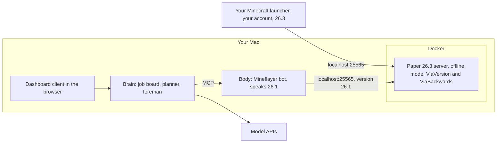

# Deployment Strategy

Goals: run on the **latest Minecraft Java release (26.3)** and **never need a second Minecraft account**.

**Update, October 10, 2026.** Production is the existing Apex world, switched from vanilla to Paper 26.3, still in online mode. Players keep the normal launcher. The helper will be server code, not a joining client, so it never needs a Microsoft account. `04-mvp-plan.md` is the current plan. The private offline server below stays a practice option.

Facts checked October 8, 2026:

| Thing | Latest | Supports 26.3? |
|---|---|---|
| Minecraft Java | 26.3 (Sep 15, 2026); 26.4 is in snapshots | - |
| Paper server | 26.3 build available | Yes |
| Fabric loader | 26.3 | Yes |
| Mineflayer (bot library) | 4.39.0 (Sep 6, 2026) | **No, stops at 26.1** |
| ViaVersion / ViaBackwards (version translators) | ViaVersion 5.12.0 (Sep 18); ViaBackwards with 26.3 server support | Yes |
| ViaProxy (standalone translator) | 3.4.14 (Sep 27) | Yes |
| Baritone | v1.20.0 (Sep 23) | Yes |
| Carpet mod (server-side fake players) | 26.3 (Sep 15) | Yes |

---

## The short story

Production is the Apex world you already play on. Switch that server from vanilla to Paper 26.3, keep online mode on, and keep the world. Friends join with the normal launcher. The helper is a Paper plugin: the server creates it, it never logs into Microsoft, and another helper later is another instance of the same plugin.

The steps, the version trap (do not pick Paper 26.2), and the milestones are in `04-mvp-plan.md`. That doc wins.

The private offline Mineflayer server below is retired. It was the way to avoid a second account before we decided to stay on Apex. Mineflayer still stops at 26.1, so that path needed a translator and could not run on Apex's online-mode world without a paid login.

---

## The options, compared

| Option | Latest version? | Extra account? | Play beside it? | Effort | Notes |
|---|---|---|---|---|---|
| **B. Paper plugin on the Apex world** (decided Oct 10) | Yes. ViaVersion covers the gap when a newer client ships first | No | Yes | High: movement and actions are server code | Online mode stays on. Vanilla clients. |
| A. Private server + Mineflayer bot + translator | Yes, via ViaBackwards | No | Yes | Low, but the wrong server | Retired. Practice only if we ever need it. |
| C. Bot drives your own character (Baritone + client mod) | Yes (Baritone 26.3) | No | No, it *is* you | Medium | Good for "work while I'm away" |
| D. Singleplayer "Open to LAN" | Same version gap as A | No | Yes | Low | Vanilla LAN checks accounts; needs an extra mod. Not recommended |
| Second Microsoft account | - | **Yes** | Yes | - | Ruled out Oct 10 |
| Realms or public servers | - | **Yes** | Yes | - | They always check accounts, and many ban bots. Ruled out |

### Why B now

Apex stays the world you and your girlfriend already use. Paper is a drop-in for vanilla on the same version: same address, same launcher, a plugin folder added. The helper sees real block and inventory state, because it is inside the server. Account checks stay on for people. Scaling is another spawned player, not another Microsoft login.

The cost is the one we already knew: movement and actions are written for Paper, not taken from Mine AI MCP's Mineflayer body. Their action list and diamond progression stay the spec. Carpet's fake players are the same idea on Fabric; we use Paper so a content mod never forces her client to change.

When she launches a version newer than the server (26.4 and after), update Paper to that version, or add ViaVersion until the Paper build exists. She still installs nothing.

### Why not D

Vanilla "Open to LAN" checks accounts for anyone joining by address. Turning that off needs a client mod (such as Lan Server Properties / mcwifipnp or OfflineLAN), and the world only runs while your game is open. A small dedicated server is simpler and can run overnight while you're not playing.

### Retired caveat, option A only

ViaBackwards shows blocks and items that are newer than 26.1 to a Mineflayer bot as the closest older equivalent. This does not apply to the Paper plugin. The plugin runs on the server's real version.

---

## Retired: how option A was set up

Kept so the private-server design is still written down. Do not follow it for Apex.

### What runs where



### Proposed repo layout

```
minegent/
  docs/              research, plan, deployment
  infra/             Minecraft server Docker setup (real world and lab world)
  packages/
    body/            Mineflayer bot, reflexes, actions, MCP endpoint
    brain/           job board, planner, foreman, inspector
    notebook/        SQLite schema and queries shared by body and brain
    blueprint/       design shapes, compiler, bill of materials
    client/          web dashboard
```

pnpm workspaces for the packages. One open decision for Phase 2: Mine AI MCP runs its TypeScript directly on Bun. We either keep Bun for the body or move it to Node LTS. Decide once we've ported it and can see what it depends on.

### The server

A Docker Compose file using the widely used `itzg/minecraft-server` image. It downloads Paper and the plugins from Modrinth automatically:

```yaml
services:
  minecraft:
    image: itzg/minecraft-server
    environment:
      EULA: "TRUE"
      TYPE: PAPER
      VERSION: "26.3"
      ONLINE_MODE: "FALSE"
      DIFFICULTY: normal
      MODRINTH_PROJECTS: |
        viaversion
        viabackwards
    ports:
      - "127.0.0.1:25565:25565"
    volumes:
      - ./data:/data
    restart: unless-stopped
```

Notes:
- `127.0.0.1:25565` means only your Mac can connect. That's what keeps offline mode safe.
- Make yourself operator through the server console (`docker compose exec minecraft rcon-cli op <yourname>`). **Never op the bot.** That's what keeps it legit.
- A second copy of this service (different port and data folder) becomes the lab world for testing, where cheating during setup is allowed.

### The bot connection

The bot connects as a 26.1 client with no account:

```ts
const bot = mineflayer.createBot({
  host: '127.0.0.1',
  port: 25565,
  username: 'Builder',
  auth: 'offline',
  version: '26.1'
})
```

The version has to be set explicitly. The server announces 26.3, which Mineflayer doesn't know yet, and ViaBackwards handles the translation once the bot says it's 26.1.

### What you install

- Docker (Docker Desktop or OrbStack) on your Mac
- The normal Minecraft launcher with your own account, set to 26.3
- Node LTS and pnpm (plus Bun if we keep Mine AI MCP's runtime)
- API keys for the model providers you pick
- Optional: Litematica (Fabric, client side) to see a ghost preview of castle blueprints in your world

### Keeping long jobs alive

A castle can take all night. If your Mac sleeps, the server and bot stop.
- **For now:** run `caffeinate -dims` while a long mission runs. The job board means a stop costs nothing but time.
- **Later:** move the same Docker setup to a small always-on cloud machine (about 4 CPU cores and 8 GB of RAM to start) and join it over a private VPN such as Tailscale. Still offline mode, still private, and still no account for the bot.

---

## When Minecraft updates

What happened with 26.3, to set expectations:

| Piece | 26.3 support arrived |
|---|---|
| Minecraft 26.3 | Sep 15 |
| Carpet mod | Sep 15 (same day) |
| ViaVersion and ViaProxy | Sep 18 (3 days) |
| Baritone | Sep 23 (8 days) |
| Mineflayer | Not yet (stops at 26.1) |

Update routine:
1. Wait for ViaBackwards to support the new version. Its README says releases come "a few days after" a Minecraft update.
2. Back up `infra/data` (the world).
3. Change `VERSION` in the compose file and restart. The image fetches the matching Paper and plugin builds.
4. Run the lab's quick check (walk, mine, craft, place, fight) before resuming real missions.
5. Leave the bot's version alone until Mineflayer supports a newer one. Then bump it and run the full lab suite.

If a new release breaks the translator badly, the fallback is to hold the server one version back until fixes land. The world save only moves forward, so don't downgrade a world that has already opened in the newer version.

---

## Safety checklist

- The server port is bound to `127.0.0.1` (or to your home network or VPN only). Never port-forward it.
- The bot isn't operator. Only you are.
- API keys live in a `.env` file that is git-ignored.
- Daily world backups (the itzg image can do this with its backup companion container, or with a simple copy job).
- A spending limit set at each model provider.

---

## Phase 1 checklist (retired with option A)

Do not follow this. Current first steps are M0 and M1 in `04-mvp-plan.md`: switch Apex to Paper 26.3, then spawn the helper from a plugin on a local Paper practice world.

---

## Sources

- Minecraft 26.3: [minecraft.net](https://www.minecraft.net/en-us/article/minecraft-java-edition-26-3)
- Mineflayer supported versions: [docs](https://github.com/PrismarineJS/mineflayer/blob/master/docs/README.md), [26.x support issue](https://github.com/PrismarineJS/mineflayer/issues/3893)
- ViaBackwards: [github.com/ViaVersion/ViaBackwards](https://github.com/ViaVersion/ViaBackwards), [releases](https://github.com/ViaVersion/ViaBackwards/releases)
- ViaVersion releases: [github.com/ViaVersion/ViaVersion/releases](https://github.com/ViaVersion/ViaVersion/releases)
- ViaProxy: [github.com/ViaVersion/ViaProxy](https://github.com/ViaVersion/ViaProxy)
- itzg Docker image: [Paper docs](https://github.com/itzg/docker-minecraft-server/blob/master/docs/types-and-platforms/server-types/paper.md), [Modrinth auto-download](https://docker-minecraft-server.readthedocs.io/en/latest/mods-and-plugins/modrinth/)
- Carpet fake players: [fabric-carpet](https://github.com/gnembon/fabric-carpet), [fake players overview](https://deepwiki.com/gnembon/fabric-carpet/4.1-fake-players)
- Automatone (server-side Baritone fork, stopped at 1.20.1): [changelog](https://github.com/Ladysnake/Automatone/blob/main/changelog.md)
- LAN and online mode: [Minecraft Wiki](https://minecraft.wiki/w/Tutorial:Setting_up_a_LAN_world), [SKlauncher LAN docs](https://docs.skmedix.pl/servers/lan-world), [Lan Server Properties](https://github.com/rikka0w0/LanServerProperties)
- Mindcraft on account requirements: [README](https://github.com/mindcraft-bots/mindcraft#online-servers)
- Mine AI MCP: [github.com/aibengineering/mine-ai-mcp](https://github.com/aibengineering/mine-ai-mcp)
