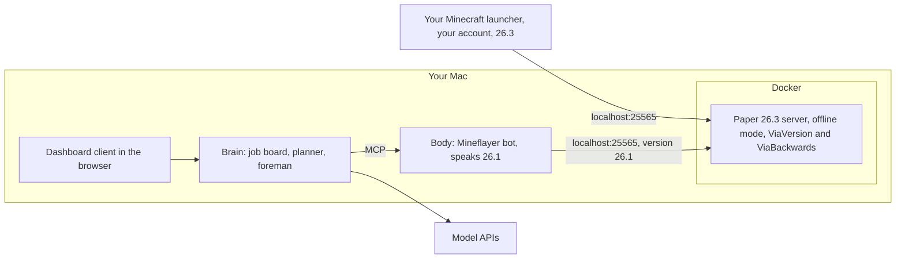

# Deployment Strategy

Goals: run on the **latest Minecraft Java release (26.3)** and **never need a second Minecraft account**.

Facts checked October 8, 2026:

| Thing | Latest | Supports 26.3? |
|---|---|---|
| Minecraft Java | 26.3 (Sep 15, 2026); 26.4 is in snapshots | - |
| Paper server | 26.3 build available | Yes |
| Fabric loader | 26.3 | Yes |
| Mineflayer (bot library) | 4.39.0 (Sep 6, 2026) | **No, stops at 26.1** |
| ViaVersion / ViaBackwards (version translators) | ViaVersion 5.12.0 (Sep 18); ViaBackwards with 26.3 server support | Yes |
| ViaProxy (standalone translator) | 3.4.14 (Sep 27) | Yes |
| Baritone | v1.20.0 (Sep 23) | Yes |
| Carpet mod (server-side fake players) | 26.3 (Sep 15) | Yes |

> **Update, October 21, 2026:** the real world now lives on an Apex Hosting server, and the agents run on an always-on cloud machine. See `05-cloud-deployment.md`. The local Docker server described below is now the lab world only.

---

## The short story

Your Minecraft account stays yours, and the bot never logs into Microsoft.

You run a small private Minecraft server on your own Mac, inside Docker, on version 26.3. The server is set to **offline mode**, which means it doesn't ask Microsoft "is this a real paid account?" when someone joins. You join with your normal launcher and account, exactly as usual. The bot joins as a second player with any name you like, such as "Builder," with no account at all.

There's one wrinkle. The bot library (Mineflayer) only speaks up to Minecraft 26.1, and the game is now at 26.3. So the server runs a free translator plugin called **ViaBackwards** that lets a 26.1 player join a 26.3 world. The bot says "I'm 26.1," the server translates, and everyone is in the same world.

Because offline mode means "no account checks," the server must stay private: only your Mac, or your home network, or a private VPN if friends join. Never open it to the internet.

When Minecraft updates (26.4 and beyond), you update the server and the translator, which usually takes a few days after the release, and the bot keeps working without changes.

Later, if we want to stop depending on the translator, we can move the bot's body *inside* the server as a mod. That removes the version gap entirely. The brain doesn't change, because it talks to the body through the same set of tools either way.

---

## The options, compared

| Option | Latest version? | Extra account? | Play beside it? | Effort | Notes |
|---|---|---|---|---|---|
| **A. Private server + Mineflayer bot + translator** (recommended now) | Yes, via ViaBackwards | No | Yes | Low: reuses Mine AI MCP's body | Translator adds a small risk of glitches |
| B. Bot body as a server mod (fake player) | Yes, same day | No | Yes | High: write movement and actions in Java | Best long-term; server can stay in online mode |
| C. Bot drives your own character (Baritone + client mod) | Yes (Baritone 26.3) | No | No, it *is* you | Medium | Good for "work while I'm away" |
| D. Singleplayer "Open to LAN" | Same version gap as A | No | Yes | Low | Vanilla LAN checks accounts; needs an extra mod. Not recommended |
| Second Microsoft account | - | **Yes** | Yes | - | Ruled out |
| Realms or public servers | - | **Yes** | Yes | - | They always check accounts, and many ban bots. Ruled out |

### Why A first

It gets a working agent fastest. Mine AI MCP's body, the one that beat the dragon, is built on Mineflayer and is MIT licensed, so we start with proven parts instead of a blank page. ViaBackwards already supports 26.3 servers, so "latest version" works today.

### Why B later

The translator is the one piece we don't control. Mine AI MCP showed how much reliability depends on the bot seeing exactly the right inventory and block state. Every translation step is a place where that can drift. A server-side body sees the real game state directly, works on new versions the day the mod is updated (Carpet shipped 26.3 support on release day), and lets the server keep account checks on for humans, since the bot never connects over the network at all. The cost is rewriting movement and actions in Java. The old server-side Baritone fork (Automatone) stopped at Minecraft 1.20.1, so there's nothing to reuse there.

### Why not D

Vanilla "Open to LAN" checks accounts for anyone joining by address. Turning that off needs a client mod (such as Lan Server Properties / mcwifipnp or OfflineLAN), and the world only runs while your game is open. A small dedicated server is simpler and can run overnight while you're not playing.

### The one caveat with A

ViaBackwards shows blocks and items that are newer than 26.1 to the bot as the closest older equivalent. So the bot won't knowingly use 26.2 and 26.3 additions (for example poplar wood or cushions) in builds until Mineflayer itself supports those versions. For the dragon and the mansion this doesn't matter. For castles, we design with blocks that exist in 26.1, which is almost all of them.

---

## Zoom in: how A is set up

### What runs where



### Proposed repo layout

```
minegent/
  docs/              research, plan, deployment
  infra/             Minecraft server Docker setup (real world and lab world)
  packages/
    body/            Mineflayer bot, reflexes, actions, MCP endpoint
    brain/           job board, planner, foreman, inspector
    notebook/        SQLite schema and queries shared by body and brain
    blueprint/       design shapes, compiler, bill of materials
    client/          web dashboard
```

pnpm workspaces for the packages. One open decision for Phase 2: Mine AI MCP runs its TypeScript directly on Bun. We either keep Bun for the body or move it to Node LTS. Decide once we've ported it and can see what it depends on.

### The server

A Docker Compose file using the widely used `itzg/minecraft-server` image. It downloads Paper and the plugins from Modrinth automatically:

```yaml
services:
  minecraft:
    image: itzg/minecraft-server
    environment:
      EULA: "TRUE"
      TYPE: PAPER
      VERSION: "26.3"
      ONLINE_MODE: "FALSE"
      DIFFICULTY: normal
      MODRINTH_PROJECTS: |
        viaversion
        viabackwards
    ports:
      - "127.0.0.1:25565:25565"
    volumes:
      - ./data:/data
    restart: unless-stopped
```

Notes:
- `127.0.0.1:25565` means only your Mac can connect. That's what keeps offline mode safe.
- Make yourself operator through the server console (`docker compose exec minecraft rcon-cli op <yourname>`). **Never op the bot.** That's what keeps it legit.
- A second copy of this service (different port and data folder) becomes the lab world for testing, where cheating during setup is allowed.

### The bot connection

The bot connects as a 26.1 client with no account:

```ts
const bot = mineflayer.createBot({
  host: '127.0.0.1',
  port: 25565,
  username: 'Builder',
  auth: 'offline',
  version: '26.1'
})
```

The version has to be set explicitly. The server announces 26.3, which Mineflayer doesn't know yet, and ViaBackwards handles the translation once the bot says it's 26.1.

### What you install

- Docker (Docker Desktop or OrbStack) on your Mac
- The normal Minecraft launcher with your own account, set to 26.3
- Node LTS and pnpm (plus Bun if we keep Mine AI MCP's runtime)
- API keys for the model providers you pick
- Optional: Litematica (Fabric, client side) to see a ghost preview of castle blueprints in your world

### Keeping long jobs alive

A castle can take all night. If your Mac sleeps, the server and bot stop.
- **For now:** run `caffeinate -dims` while a long mission runs. The job board means a stop costs nothing but time.
- **Now superseded:** the world moved to Apex and the agents to an always-on cloud machine. See `05-cloud-deployment.md`.

---

## When Minecraft updates

What happened with 26.3, to set expectations:

| Piece | 26.3 support arrived |
|---|---|
| Minecraft 26.3 | Sep 15 |
| Carpet mod | Sep 15 (same day) |
| ViaVersion and ViaProxy | Sep 18 (3 days) |
| Baritone | Sep 23 (8 days) |
| Mineflayer | Not yet (stops at 26.1) |

Update routine:
1. Wait for ViaBackwards to support the new version. Its README says releases come "a few days after" a Minecraft update.
2. Back up `infra/data` (the world).
3. Change `VERSION` in the compose file and restart. The image fetches the matching Paper and plugin builds.
4. Run the lab's quick check (walk, mine, craft, place, fight) before resuming real missions.
5. Leave the bot's version alone until Mineflayer supports a newer one. Then bump it and run the full lab suite.

If a new release breaks the translator badly, the fallback is to hold the server one version back until fixes land. The world save only moves forward, so don't downgrade a world that has already opened in the newer version.

---

## Safety checklist

- The server port is bound to `127.0.0.1` (or to your home network or VPN only). Never port-forward it.
- The bot isn't operator. Only you are.
- API keys live in a `.env` file that is git-ignored.
- Daily world backups (the itzg image can do this with its backup companion container, or with a simple copy job).
- A spending limit set at each model provider.

---

## Phase 1 checklist (first deployment)

1. Install Docker and pnpm.
2. Create `infra/docker-compose.yml` from the example above and start it.
3. Join `localhost` from your normal launcher on 26.3. Op yourself from the console.
4. Write the smallest possible bot: connect as `Builder` with version 26.1, say hello in chat, and walk to you on `!come`.
5. Confirm through the translator that the bot sees the right blocks, inventory, and health, and that it can mine, craft, and place one block correctly.
6. Update the roadmap in `02-how-we-make-it-better.md` with what worked, what didn't, and anything Phase 2 needs to know.

---

## Sources

- Minecraft 26.3: [minecraft.net](https://www.minecraft.net/en-us/article/minecraft-java-edition-26-3)
- Mineflayer supported versions: [docs](https://github.com/PrismarineJS/mineflayer/blob/master/docs/README.md), [26.x support issue](https://github.com/PrismarineJS/mineflayer/issues/3893)
- ViaBackwards: [github.com/ViaVersion/ViaBackwards](https://github.com/ViaVersion/ViaBackwards), [releases](https://github.com/ViaVersion/ViaBackwards/releases)
- ViaVersion releases: [github.com/ViaVersion/ViaVersion/releases](https://github.com/ViaVersion/ViaVersion/releases)
- ViaProxy: [github.com/ViaVersion/ViaProxy](https://github.com/ViaVersion/ViaProxy)
- itzg Docker image: [Paper docs](https://github.com/itzg/docker-minecraft-server/blob/master/docs/types-and-platforms/server-types/paper.md), [Modrinth auto-download](https://docker-minecraft-server.readthedocs.io/en/latest/mods-and-plugins/modrinth/)
- Carpet fake players: [fabric-carpet](https://github.com/gnembon/fabric-carpet), [fake players overview](https://deepwiki.com/gnembon/fabric-carpet/4.1-fake-players)
- Automatone (server-side Baritone fork, stopped at 1.20.1): [changelog](https://github.com/Ladysnake/Automatone/blob/main/changelog.md)
- LAN and online mode: [Minecraft Wiki](https://minecraft.wiki/w/Tutorial:Setting_up_a_LAN_world), [SKlauncher LAN docs](https://docs.skmedix.pl/servers/lan-world), [Lan Server Properties](https://github.com/rikka0w0/LanServerProperties)
- Mindcraft on account requirements: [README](https://github.com/mindcraft-bots/mindcraft#online-servers)
- Mine AI MCP: [github.com/aibengineering/mine-ai-mcp](https://github.com/aibengineering/mine-ai-mcp)
