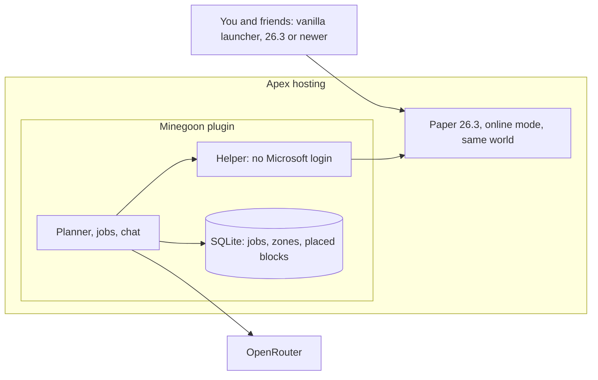

# MVP Plan

Written October 9, 2026. Updated October 10, 2026: production is Paper on the existing Apex world, and the helper is a plugin. Builds on `01-sota-research.md`, `02-how-we-make-it-better.md`, and `03-deployment-strategy.md`. Where this doc disagrees with those, this doc wins for the MVP.

---

## The short story

A helper lives in your Apex world, the same 26.3 survival world you and your friends play in. You talk to it in chat.

You type `get 5 diamonds` (a `!` in front still works). It works out what that needs (an iron pickaxe, which needs iron, which needs a furnace and coal, which needs a stone pickaxe, and so on down to punching a tree), skips whatever it already has, and goes and does the rest. It mines blocks it can see, fights off or runs from mobs, eats when hungry, and retreats if a fight is going badly. When it's done, it comes back to you and drops the diamonds at your feet.

It plays fair. It follows survival rules, never gets operator rights, and can't use commands. It's careful with your builds: by default it won't break blocks that look player-made, and it never touches areas you've marked.

Most of the work is done by code: a Paper plugin that mines, crafts, and walks, plus our own code that walks the recipe tree and checks every job against the game. Mine AI MCP's action list is the spec for those hands, not a program we run. A model (through OpenRouter) reads free-text chat, and it also chooses the next move whenever the helper is about to head out, a search comes up empty, or a step fails.

On the technical side: Apex stays your world, switched from vanilla to **Paper 26.3**. Paper is the same game with a place to load your own server code. Your girlfriend keeps the normal launcher and joins the same address. The helper will live inside that server, so it never logs into Microsoft and never needs its own account. Online mode stays on, so real players still do.

---

## What you'll be able to do

| Command | What happens |
|---|---|
| `get <count> <item>` | Gets any survival item, gathering, crafting, and smelting everything needed. Example: `get 5 diamond`, `get 64 oak_log`, `get 1 bucket`. A `!` in front is optional. `get me 5 diamonds`, `grab some oak logs`, and `fetch a stack of torches` are the same command. "a few" is 3, "a couple" is 2, "some" is 8, "a stack" is 64. No model. |
| Plain chat with its name | `Builder, I need a bucket` is turned into a command by a small model, when the line is not already a command like the row above |
| `come` | Walks to you. `come here` is the same |
| `give` | Comes to you and drops what it gathered |
| `status` | Current job, inventory highlights, health, recent problems |
| `inventory` | Opens a live view of what the helper is carrying: armor, off hand, pack, and hotbar. Look only; clicks change nothing. `/minegoon inventory` from the console prints the same contents as text. `inv` is the short form |
| `stop` / `pause` / `resume` | Stops or pauses the current task |
| `protect <radius>` | Marks the area around you as off-limits for breaking. `protect this area` uses 16 blocks |
| `allow <radius>` | Lifts the careful-building rule in an area for the current task (for example, "tear down that dirt hut") |
| `watch` / `back` | Follows the helper in spectator, through its eyes. `back` returns you to where you were, in the game mode you had. Anyone can use it. Nobody is moved unless they ask |

When a `!get` finishes, the bot comes back to you and hands the items over on its own.

---

## Decisions so far

| Question | Answer |
|---|---|
| Server | Apex, Paper 26.3, online mode, same world |
| Where the helper runs | Inside the Apex server, as server code |
| Model access | OpenRouter only (Claude, Gemini, and later Jev are all reachable through it) |
| "Come back" | Come back to you and hand over the items |
| Builds | Careful by default; can be overridden for a task |
| Players | You and a few friends, normal vanilla launchers |
| Bot account | None |

### Server software: decided, Paper on the same world

Decided October 10, 2026. This replaces the October 9 choice of a second Java account.

Vanilla has no place to add server code, so a helper there has to log in as a real player. Paper is Mojang's game plus a plugin folder. Players still use the normal launcher. The helper is created by the server itself, the way a minigame server creates NPCs, so Microsoft is never asked and a second account is never bought. Online mode stays on. Friends keep joining with their real accounts. Adding another helper later is another instance of that same server code, not another login.

Fabric was the other one-click option on Apex. It can also run server-only mods, but Apex treats it as a modded server, and one content mod would force every player to install Fabric and match versions. Paper plugins leave the client alone.

**What she does.** Nothing changes. Same server address, vanilla launcher, newest release she already has (26.3 today). When 26.4 ships, either update Apex to Paper 26.4 once that build exists, or drop [ViaVersion](https://hangar.papermc.io/ViaVersion/ViaVersion) into `plugins/` for the few days before that. ViaVersion lets a newer vanilla client join an older server. She still installs nothing. New blocks from 26.4 appear only after the server itself updates. Last time that plugin landed three days after the release (26.3 on Sep 15, ViaVersion on Sep 18).

**What you do once, in the Apex panel.** Paper's own steps are in [Migrating to Paper](https://docs.papermc.io/paper/migration/). Apex's panel steps are in [Change your server version](https://apexminecrafthosting.com/guides/minecraft/control-panel/how-to-change-your-server-version/).

1. Stop the server. In the panel, create a backup, and also download that world zip to your Mac. Apex keeps only one panel backup at a time.
2. In **Game File**, search `Paper` and pick **26.3**, the same version the world is already on. Do not pick Paper 26.2. A 26.3 world will not load on 26.2.
3. Press **Change Version**. If a prompt offers a new world, or **Reset Server Files**, decline it. Switching does not delete files on its own. Keep this world.
4. Restart. Join from your normal 26.3 launcher. Check the base, a Nether portal, and the End if you have been there. Then she joins the same way.
5. Leave `online-mode=true`. Leave the whitelist as it is.

Paper 26.3 is still the beta channel. As of October 9, 2026 the newest build is **169** ([downloads](https://papermc.io/downloads/paper), experimental builds on; the front page still features stable 26.2). If the dropdown has no Paper 26.3, stop and use Apex's custom jar flow with that 26.3 build, named the way the panel asks (usually `custom.jar`). Do not fall back to 26.2.

Paper may nudge a few mechanics (mob caps, redstone timing). Play first. Tune those configs only if a farm feels wrong.

Going back to the vanilla jar is possible, but Paper moves a handful of level files on first start. Follow [Paper's migration guide](https://docs.papermc.io/paper/migration/) rather than only swapping the jar. The downloaded backup is the clean undo.

---

## How it fits together



Everything runs inside the plugin on the server. Your Mac is only needed for the practice server.

One `!get` goes like this:

1. **Chat.** The bot sees `get 5 diamond`, or a sentence such as `get me a few diamonds`. If you name the helper and the line is not already a command, a small model turns it into one.
2. **Plan.** Our code works out the steps backwards from diamonds. It needs an iron pickaxe, which needs 3 iron ingots and sticks; the ingots need raw iron smelted with fuel; the raw iron needs a stone pickaxe; and so on. It drops anything already in the inventory and writes the remaining jobs to the job board in SQLite.
3. **Do.** Each job runs on one server action: collect, craft, smelt, place, equip. The plugin performs it and returns a receipt of what the world actually did.
4. **Survive.** Reflexes in the plugin fight, run away, and eat without being asked. Our retreat rules end the trip early if the bot is badly hurt, running out of food, or about to break its last pickaxe.
5. **Check.** After each job, the inspector confirms the result in the game, such as the inventory count. Only then is the job marked done.
6. **Recover.** A search follows a short list of moves from the knowledge file (for iron: rock faces, then peaks, then caves, then stairs down to y=14). A failed step is retried, then replanned, then planned around the source that failed. The task is never given up on its own. When a search has come up dry, or a step has failed six times, a model is asked for one new idea, and an idea that works is kept as a lesson.
7. **Return.** The bot walks back to you and drops the items.

---

## What we reuse and what we build

**Spec, from Mine AI MCP (MIT license). Read it, do not run it.** Their body is a Mineflayer client, which cannot spawn inside Paper and cannot join this online-mode world without an account. Take the behavior, rewrite it as plugin actions:

- The action list: collect (find, mine, pick up, close off lava first), craft, smelt, place, equip, eat, drop at a named player, pick up items after a death, navigate.
- The reflex settings, such as the health level below which it stops picking fights.
- The receipt idea: every action reports what the world actually did.
- Their progression script `scenarios/default/progression/progression-to-diamond.ts` as the order of work for a diamond trip.

**Reused from elsewhere:**
- The `itzg/minecraft-server` Docker image for the local practice server, set to Paper 26.3.
- Paper's API for block, inventory, and player data. Spawning the helper itself is the one piece that has to touch server internals, and that code stays in one file so a Minecraft update only breaks that file.

**Built by us:**
- **The Paper plugin.** It spawns the helper, listens to chat, runs actions, and holds the job board in the plugin data folder. A trip keeps going when your Mac is asleep, because the plugin is on Apex.
- **The "get anything" planner:** working backwards from the item you asked for to raw materials. Recipes come from the running server itself, and tool tiers from the server's own block data, so they always match the game version. A short hand-written table says which blocks and passive mobs drop what.
- **The job board and inspector.**
- **Trips:** finding a block it can see, the retreat rules, and walking back to you.
- **Build safety:** the navigator refuses to break protected blocks.
- **Chat commands and model calls** through OpenRouter. The key lives in the plugin config on the server, not in git.
- **Practice runs:** a script that runs trips over and over on a copy of your world and records the results.

---

## Zoom in

### 1. Connecting to Apex

- The server is Paper 26.3 in online mode. Real players log in with Microsoft, as they do now.
- The helper is spawned by our plugin. It has an inventory and a position, and it never opens a client connection, so it has no account.
- Never give the helper operator rights. That's what keeps it from cheating, even by accident.
- Do not install a third-party fake-player plugin. The ones that exist stop short of 26.3 or only puppet a player for farms. Our plugin owns spawning and actions.
- ViaProxy, Mineflayer, and a second account are retired. Mineflayer still only speaks 26.1.

### 2. The "get anything" planner

**What it is:** a function that turns "5 diamond" into an ordered list of jobs.

**How it works:**
- Every item has a source. It's crafted (handed to `craft_item`), smelted (input plus fuel), dropped by a block that needs a certain tool tier, or dropped by a mob.
- The planner works backwards from the item, subtracts what's already in the inventory, and adds tool requirements on the way (diamond ore needs an iron pickaxe or better).
- Shared needs are merged. Iron needed for both a pickaxe and a bucket becomes one "get raw iron" job.
- Mob-drop items (string, leather) are allowed only for passive mobs in the MVP. Hostile drops wait for the combat phase.

**Why code and not a model:** recipes have one right answer, and code gets it right every time for free.

### 3. Job board and inspector

- Each job is a SQLite row: what to do, its "done when" check, status, attempts, and the last failure reason.
- Checks only use game facts: an inventory count, an equipped item, a position, or a block state.
- If the program restarts, it re-checks the job it was on and continues.
- Deaths: the bot logs where it died, and a "go back for my items" job jumps to the front of the queue using `pick_up_items` with `recover_death_items`. That only works within 5 minutes, because dropped items disappear.

### 4. Trips and coming back

- **Going down.** The bot looks through everything within the server's render distance for blocks it can see from where it stands, and walks to the nearest one. A block counts when a face is open to air or water and a straight look from its eyes reaches that opening without crossing a solid block. Buried ore is invisible to it, and so is the inside of a dark cave when it stands in daylight. Its route digs a staircase rather than a straight drop, so it can walk back up. If nothing is in sight, it works through the moves the knowledge file lists for that thing, then heads toward ground it has not seen and starts the list again.
- **Retreat rules (code, not model).** The bot ends the trip and comes back when any of these happens:
  - health stays below 10 after the reflexes have finished
  - it runs out of food
  - its last pickaxe of the needed tier is nearly broken
  - its inventory is full
  - you type `!stop`
- **Finding you.** The plugin asks the server where every online player is, so it is not limited to what a client could see. It walks to you. If you are offline or in another dimension, it goes to the spot where you gave the task and drops the items there, marked as yours.
- **Handing over.** The drop action walks to you and tosses the items.

### 5. Being careful with your builds

Vanilla doesn't record who placed a block, so "player-made" has to be a well-chosen guess. The rule lives in our navigator, which decides for every block whether breaking it is allowed, more expensive, or forbidden:

- **Always forbidden:** anything inside a `!protect` zone.
- **Forbidden by default:** block types that rarely appear naturally underground or in the wild: planks, glass, bricks, stone bricks, wool, concrete, beds, chests, doors, torches, rails, crafting tables, furnaces, and so on. These can still appear in villages and mineshafts, so in those places the bot treats them as off-limits too, which is the safe side.
- **Allowed:** natural blocks, plus blocks the bot placed itself (its own scaffolding and staircase blocks, which it records in SQLite).
- **Override for a task:** `!allow <radius>`, or a request the model clearly reads as "break this" ("tear down that dirt hut"), lifts the default rule in that area for that task only. `!protect` zones can never be overridden.

### 6. Where models are used

All model calls go through OpenRouter, so swapping models is a config change.

| Use | Model | When |
|---|---|---|
| Turning free-text chat into a command | Small, fast model (Gemini Flash or Sonnet class) | When you talk to the bot instead of typing a `!` command |
| A new idea when the knowledge falls short | `advice-model` in the config | A search came up dry, or a step failed six times |
| Everything else | No model | Recipes, crafting, smelting, searching, fighting, reflexes, checks, retreats, handing items over |

A trip that goes well makes no model calls at all. The advice call gets a short briefing: the thing, the moves already listed for it, the biome, and what went wrong. Its answer is a list of moves. If that list finds the thing, it is saved in `lessons.json` and tried first next time; one that misses twice is dropped, so the file stays short.

### 7. Practice before the real world

- Download a copy of your Apex world and run it locally in Docker as Paper 26.3, bound to `127.0.0.1`. This is the practice world. Same software as Apex, so a plugin that works here works there. M1 through M4 happen here, before the plugin is uploaded to Apex.
- A script restores the world copy, runs a trip such as `!get 5 diamond` from a set start point, and records whether it succeeded, how long it took, deaths, model calls, and whether any protected blocks were broken. Then it repeats.

### 8. Easy to run

- The helper starts with the Paper server. It greets in chat when it spawns.
- The OpenRouter key lives in the plugin config on the server. That file is not committed.
- Code layout: one Paper plugin. Java 25, the same runtime Apex already uses for 26.3.

```
minegoon/
  docs/
  infra/          practice server (Docker, Paper 26.3)
  server/         the Paper plugin
    spawn/        create the helper; the only file that touches server internals
    world/        block snapshots, positions, and the route finder
    actions/      mine, craft, smelt, place, move, each returns a receipt
    planner/      "get anything" recipe planner
    jobs/         job board and inspector
    knowledge/    where things are, how to look for them, and lessons kept
    trips/        searching, going down, fighting, retreat rules, returning to you
    safety/       protected blocks and zones
    chat/         commands and the free-text parser
    models/       OpenRouter calls and briefings
  scripts/        practice-run script
```

---

## Milestones

Each milestone has an exit test. Update the status and notes as each one finishes.

| # | What | Exit test | Status |
|---|---|---|---|
| M0 | **Paper switch** | Apex is Paper 26.3, same world, online mode still on. You and your girlfriend join with the normal 26.3 launcher, same address. Base, Nether, and End still look right. No second account. | Not started |
| M1 | **Helper exists** | On the local Paper 26.3 practice world, the plugin spawns the helper with no account. A normal 26.3 client sees it. `!come`, `!status`, and `!stop` work. It mines, crafts, smelts, and places once each, and every receipt matches the world. | Mostly done. Spawns with no account on build 169; mines, crafts, smelts, places; status, stop, pause, resume work from the console. Not yet checked: seeing it from a real client, and `!come` / chat from a real player. |
| M2 | **Get anything** | `!get` works for: oak_log, stone_pickaxe, iron_ingot, bucket, shield, and 32 torches. Each succeeds in 8 of 10 runs from an empty inventory. Restarting the Paper server mid-run doesn't lose progress. | In progress. oak_log and wooden_pickaxe pass; iron_ingot passed 4 of 4 runs (146 to 184 s). A restart mid-run resumed and finished. Not yet run: stone_pickaxe, bucket, shield, 32 torches, and the 10-run counts. |
| M3 | **Mining trips and coming back** | `!get 5 diamond` from an empty inventory succeeds in 8 of 10 practice runs. The bot returns to you and hands over the items. At most 1 death across the 10 runs, and items recovered when it does die. | In progress. 1 diamond (102 s) and 3 diamonds (285 s) from empty succeeded with no deaths. A death during an iron run was recovered and the run finished. Not yet run: 10 runs of 5 diamonds. |
| M4 | **Build safety** | In the practice world, with a test base in the way of a trip, the bot finishes the trip without breaking a single protected or player-made block. `!allow` lets it clear a marked hut. | Started. A 30-block `!protect` zone at spawn sent it 31 blocks out for logs; zero guard catches in every run so far. Not yet run: the test base and `!allow` hut. |
| M5 | **Real world** | Back up the Apex world first. Then three supervised `!get` trips on Apex (one of them diamonds), all succeeding, with no damage to builds. Also two "hidden" items never tried in practice (for example, 64 stone_bricks and an iron_axe) succeeding on the first try. | Not started |

**The MVP is done when M5 passes.**

---

## Risks and fallbacks

| Risk | Why it matters | Fallback |
|---|---|---|
| Paper 26.3 is still beta | The world is already 26.3, so stable Paper 26.2 cannot open it. A bad build can misbehave. | Downloaded backup before the switch. If the panel has no Paper 26.3, use the custom jar for build 169 or newer. Undo with the backup, or follow Paper's migration guide back to vanilla. |
| Spawning a player is version-sensitive | Paper's public API does not include "create a survival player." That call sits on server internals and can break on the next Minecraft version. | Keep it in `server/spawn/` only. M1 proves it on 26.3 before any planner work. |
| Guessing "player-made" wrong | The bot might break something you care about | Strict defaults, `!protect` for anything important, and a world backup before every M5 session. |
| A newer launcher than the server | She updates on release day, Paper and ViaVersion follow a few days later. | Stay on the current server until ViaVersion supports her version, then drop that plugin in. Update Paper when its build for that version exists. She never installs a mod. |

---

## Not in the MVP

- Fighting hostile mobs on purpose (hunting for drops), the Nether, the End, and the dragon.
- Building anything beyond its own scaffolding and staircases.
- A web dashboard. Chat plus a log file is enough.
- Jev. Revisit for fast fight decisions in the mansion phase.
- More than one bot.
- Always-on cloud hosting.

---

## Where we are

Done: the production path is decided (Paper 26.3 on Apex, helper as a plugin, no second account), and the whole MVP plugin is written and running on the local practice server. See the milestone table for what has been proven.

Done October 14, 2026: the redesign after the long-trip suite. The helper now has a knowledge file of where things are and how to look for them (`server/src/main/resources/knowledge.yml`), sees everything unhidden within render distance, never gives up on a task, asks a model only when that knowledge falls short, and keeps what worked as lessons. It also has a fighter for hostile mobs and a cheap way to spot structures from marker blocks. The faster skills suite (`scripts/long-tasks.sh N skills`) checks each piece in minutes. Results are in `05-long-tasks.md`.

Done October 14, 2026, second half: mobility and the open problems from pass 10.

- **Moving like Baritone.** The helper no longer glides. A route is a list of typed moves (walk, sprint, swim, step up, drop, jump a gap, pillar, ladder, dig down, bridge), each costed in game ticks the way Baritone counts them. A* plans 80-block legs and plans the next one while the current one runs. Every tick an executor presses real keys (forward, jump, sprint, sneak), so gravity, water, ladders and fall damage all happen. Code: `server/src/main/java/dev/minegoon/world/path/` and `actions/PathExecutor.java`. The moves suite (`scripts/long-tasks.sh N moves`) times seven courses: a 300-block trek, a cliff, a 6-deep pit, a ravine, a gap, a lake to swim, and a pool under a lid to come up from for air.
- **Reflexes:** a water-bucket clutch on a long fall, and climbing out of lava or off a magma block.
- **Nights:** with no sword at night on the surface (just after a respawn, say), it digs two down, covers the hole, and waits for morning.
- **Tools:** a worn tool's last uses go on targets in sight. The false "no sword at night" was swords being worn out on dirt and logs; tools are now chosen by cost including wear.
- **Fights:** no strafing or backing off over a drop or into lava; an axe against a raised shield; backing off while its own shield is disabled; wears the best armor it carries; shoots a bow at range with the arrow's drop worked out, checking the arrow's whole curve first. The deep kit adds an iron helmet and chestplate, and a bow and arrows when they are cheap to make.
- **Impossible tasks:** the model is asked first when there is no plan, or nothing known about where to find a raw thing. A "no" stops the task with the reason. While a task runs, the helper reports every 10 minutes, asks for an idea after 10 minutes with no progress, and stops after 30.
- **Small things:** structures seen are saved per world; the test harness keeps lessons and structures between suite runs, and restarts the practice server if it was running.

Done after that: three full skills passes (11 to 13). Pass 13 got 45 of 57 runs, up from 38: every moves course and fight at 2 or 3 of 3, and bedrock refused up front every time. The bugs those passes found are fixed (see `05-long-tasks.md`).

Done October 15, 2026: real game speed. Passes 11 to 13 ran the helper's loops faster than the game's tick, so it mined about three times faster than a player could. Every loop now takes one real tick, which dropped pass 14 to 37 of 57 and showed a set of bugs, mostly in jungles: vines, canopies, sand refilling dug stairs, magma, a walk home that never fought, and a step clock that let one walk hang for minutes. All are fixed (see "Passes 14 to 21" in `05-long-tasks.md`). The one-repeat pass after most of the fixes got 14 of 19, including a diamond in 14 minutes. Scores from before and after the change are not comparable.

Next:

- A full three-repeat skills pass on an idle machine. The last one ran while the machine was busy and the server stalled, so the centring fix for vines and the armed walk home have no full pass yet.
- Sheep, amethyst, and diamonds, worked on in parallel.
- Moving the task-status writes off the server thread.
- Then **M0** (the panel switch, yours to do) and the M1 to M4 checks in the table.

### How to run it

- Build: `cd server && ./gradlew build`. The jar is `server/build/libs/minegoon-0.1.0.jar`. Gradle fetches Java 25 itself if needed.
- Practice: `scripts/practice.sh 10 5 diamond` builds, boots the Docker server on `127.0.0.1:25565`, runs 10 trips, and saves one line per trip under `scripts/results/`. `FRESH=1` regenerates the world from the fixed seed. The script sets the time to day before each trip so runs are comparable.
- Console: `/minegoon get|status|inventory|stop|pause|resume|come|give|protect|allow` mirror the chat commands, including the plain wording (`/minegoon get me a few diamonds`). `inventory` from the console prints the contents instead of opening a window. `/minegoon plan 5 diamond` prints the plan without doing it. `/minegoon results` lists recent tasks. `/minegoon reset` (practice only, `lab: true`) sends the helper back to spawn empty-handed.
- Model calls: put the OpenRouter key in `plugins/Minegoon/config.yml` on the server. Without it, direct commands still work (with or without `!`), other sentences are ignored, searches walk without asking, and a failed step retries once and then replans.

### What changed from the plan while building

- **Plain sentences are commands.** `get me 5 diamonds`, `come here`, `protect this area`, and the other command words work in chat with no `!` and no model. `grab`, `fetch`, and `bring` mean get. A line that is just chatting, such as `come look at this`, is left alone. Naming the helper still sends anything that is not already a command to the model.
- **A knowledge file after all.** The first build had no depth table: it only looked around and wandered. That found iron and diamonds near spawn but fell apart elsewhere. `knowledge.yml` now lists, for each thing, the heights and biomes it shows up in and the moves to look for it, in the order a player would try them. Diamonds and amethyst also have a kit (an iron pickaxe, an axe, a shield, food, blocks) that is gathered before going down the caves.
- **No x-ray.** Those searches only keep a block the helper can see: an open face, and a clear line from its eyes to the air or water in front of that face. It will not tunnel toward a vein hidden in stone. Once it breaks a block, the next scan can see whatever that opened.
- **Recipes from the server, not `minecraft-data`.** `minecraft-data` lags new versions; the server's own recipe list cannot. The cobblestone note below still holds: the planner asks for "any cobblestone", whose source is mining stone or deepslate.
- **Planner tries ways in order.** Cost guesses alone picked a diamond pickaxe as the cheapest way to mine diamonds, which needs diamonds. The planner now tries ways cheapest first and backs out of any that needs the thing it is making.
- **No give-up.** The old unstuck menu, with a model call before every step and a block after three failures, is gone. The code retries, replans, and plans around a dry source by itself, with a growing pause between tries. The model is only for new ideas (see "Where models are used").
- **Deliveries for console tasks** go to where the helper stood when the task was given.
- **Inventory peek.** `!inventory` opens a live copy of the helper's inventory. Clicks are refused, and the window keeps up while it stays open. The console gets the same contents as text.

### What is code, and what is a model

Minecraft facts and standing rules are code. The model is called when there is a real choice: heading out into the world, a search that found nothing, or a step that just failed. It is not called to invent a recipe.

Code knows:

- Where raw items come from: ores, logs, grass (wheat seeds), ripe crops, cows and the other passive animals, skeletons (bones, arrows), spiders (string), zombies (a slow way to get carrots and potatoes when no farm is growing).
- Wheat can be harvested ripe, or grown: hoe dirt, plant seeds, bone meal from bones, harvest. Bread is then the normal recipe.
- A water or lava bucket is a right-click on a source block, not a recipe.
- Hungry with nothing to eat: hunt a cow, pig, sheep, or chicken and eat it, then continue the task.
- The tool for the current step is about to break: craft another of that tool, then continue.
- Night with no sword: craft a wooden sword. Night on the surface: make a bed if needed, sleep, pick the bed back up.
- Nothing of this source in range, but another source is known: the model is told that, and it can switch. With no key, the code switches on its own.

The model does four things: turn free-text chat into a command, choose the move before a gather, hunt, grow, or fill, choose again when that search is empty, and choose again when any step fails. A third failure stops the task without another call.

Still not scripted, because they are a judgment or a different kind of action: building a shelter, fishing, villager trades, opening chests, and killing creepers for gunpowder. A creeper chase that just walks up and hits it blows the helper up.

### Known gaps

- It wears armor and shelters at night, but it still dies underground on diamond trips, and the trip back up from y=-59 often fails.
- One unexplained jump was seen early on: a run finished seconds faster than walking allows. It has not happened again in later traced runs, and was likely leftover items near spawn, which `reset` now clears. Watch for it.

## Notes for whoever starts M0

- Follow the panel steps in "Server software" above. Backup to your Mac first. Decline any new-world or reset prompt. Do not select Paper 26.2.
- After you and your girlfriend have both joined, write the result in the M0 status cell, including the Paper build number the panel installed.
- The plugin is already built; after M0, upload `minegoon-0.1.0.jar` to `plugins/` on Apex only once the M1 to M4 checks pass locally. Back up the world first.
- The planner translates item names into block names. Ask for `stone`, not `cobblestone`. In Mine AI MCP's client, asking for cobblestone sent the bot to a dungeon. `server/planner/Sources.java` keeps that translation.
