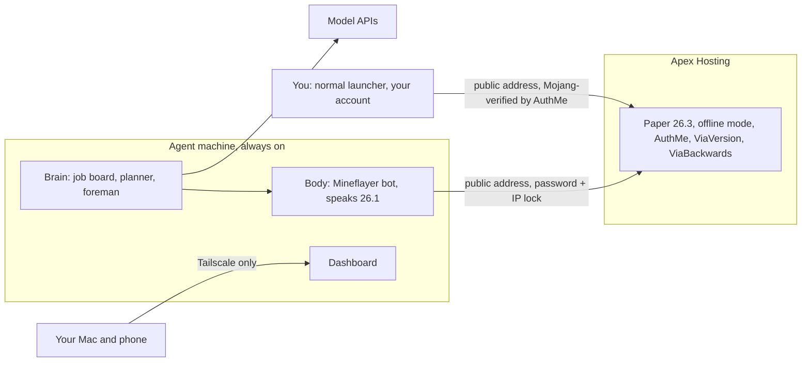

# Cloud Deployment: World on Apex, Agents on an Always-On Machine

Goals: agents run for days without your Mac, play in your Apex Hosting world on the newest Paper (26.3), and still never need a second Minecraft account.

This replaces the "real world on your Mac" part of `03-deployment-strategy.md`. The local Docker server from that doc stays as the lab world.

Facts checked October 21, 2026:

| Thing | Latest | Notes |
|---|---|---|
| Paper | 26.3 (build 209) | Apex offers it in the Game File menu |
| Mineflayer | 4.39.0 | Still stops at 26.1, so the translator is still needed |
| ViaVersion / ViaBackwards | 5.12.1 | Paper 1.10 to 26.3 |
| AuthMe Reloaded | 6.0.1 | Built-in "premium" login that checks real accounts with Mojang |
| PacketEvents | 2.14.0 | 26.3 support; AuthMe needs it for premium checks |
| FastLogin | - | Open "network protocol error on 26.3" bug, so we don't use it |

---

## The short story

There are now two machines, and each does one job.

**Apex runs the world.** Your Paper 26.3 server stays where it is. You keep joining it the way you always do.

**A small rented Linux server runs the agents.** The body (the Mineflayer bot), the brain, and the dashboard all live there. It's on 24/7, so a castle can take three days and nobody has to keep a laptop awake. The bot connects to Apex over the internet like any other player.

The hard part is the bot's account. Apex's server normally asks Microsoft "is this a real paid account?" for everyone, and the bot doesn't have one. So we turn that check off (offline mode). That alone would be dangerous, because the server is on the public internet. Anyone could type your name and walk in as you, with your operator powers.

A login plugin called **AuthMe** closes that hole. It works like a bouncer with two rules:

- **Real players** prove who they are with their Microsoft account, checked directly with Mojang. You run `/premium` once and never think about it again.
- **The bot** has a password, and AuthMe only accepts that name from the cloud machine's IP address. Someone who steals the password still can't use it from home.

AuthMe also kicks any name you haven't registered from the console, so it doubles as the whitelist.

The translator plugins (ViaVersion and ViaBackwards) sit on Apex too. They let the bot, which speaks 26.1, play in the 26.3 world.

Your dashboard is never exposed to the internet. The cloud machine joins a private network (Tailscale) with your Mac and phone, and only those devices can open it.

What it costs: roughly **$40 to $90 a month** all in, mostly Apex (which you already pay) and model API usage (which you cap).

---

## What you need to do

### Accounts to create

| Account | Why | Cost |
|---|---|---|
| Apex Hosting | You have it. Check the plan's RAM and location | What you pay now |
| Vultr | The always-on agent machine | $20 a month |
| Tailscale (Personal plan; sign in with Google or GitHub) | Private access to the machine and, later, the dashboard | Free (up to 6 users, unlimited devices) |
| Anthropic Console and/or OpenAI Platform | API keys for the planner and foreman models (from Phase 3) | Prepaid credits; you set the cap |

No second Minecraft account. No domain name. The repo is public, so the machine clones it without a GitHub key.

### Money

| Item | Monthly | Notes |
|---|---|---|
| Apex server | Current plan, maybe +$5 to $10 | The bot is a second player that loads its own chunks when it roams away from you. On less than 6 GB, expect lag during long trips. Apex lists 4 GB at $14.99, 6 GB at about $20, 8 GB at about $25 |
| Vultr machine | $20 | Regular Performance, 2 vCPUs, 4 GB. Billed hourly up to that cap. Turn off Vultr's auto backups (about +$4); nothing on the machine needs them yet |
| Model APIs | $20 to $50 to start | Both providers are prepaid: buy credits, then the API stops when they run out. Also set a monthly spend limit |
| Tailscale | $0 | |
| **Total** | **about $40 to $90** | |

For scale: the planner and foreman split in `02-how-we-make-it-better.md` is the difference between about $1 and about $93 per dragon run. While developing, loops and bugs are what burn credits, so set the cap before you hand out a key. Turn off auto-reload (OpenAI enables it by default when you first buy credits). The Phase 1 bot makes no model calls, so this can wait until Phase 3.

### Steps, in order

**On your Mac**
1. Make an SSH key if you don't have one: `ssh-keygen -t ed25519` (press Enter through the prompts). Show it with `cat ~/.ssh/id_ed25519.pub`.
2. Download the plugins: from a clone of this repo, run `infra/apex/download-plugins.sh`. It saves four checksum-verified jars in `infra/apex/plugins/`.

**On Vultr** (the machine must exist first, because Apex needs its IP)

3. Sign up at vultr.com and add a payment method.
4. Account, then SSH Keys, then Add: paste your public key from step 1.
5. Deploy a server: Shared CPU, Regular Performance, the location from the table below, Ubuntu 24.04 LTS x64, the 2 vCPU / 4 GB plan. Turn off auto backups. Select your SSH key. Under additional features, tick cloud-init user data and paste all of `infra/cloud/cloud-init.yaml`. Hostname `minegent`. Deploy.
6. Copy the server's IPv4 address. Wait about 5 minutes for first-boot setup to finish.

**On Apex** (backup first)

7. Backups, then create a backup and download it.
8. Stop the server.
9. FTP File Access, then `plugins/`: upload the four jars from step 2.
10. Open `infra/apex/authme-config.yml`, replace `REPLACE_WITH_VULTR_IP` with the IP from step 6, and upload it as `plugins/AuthMe/config.yml` (create the `AuthMe` folder if it isn't there). AuthMe fills in every other setting on startup.
11. Config Files, then Server Settings: Online Mode to Disabled. Save.
12. Start the server. In the console, check for `AuthMe ... successfully enabled` and no red errors from ViaVersion, ViaBackwards, or packetevents.
13. In the console, create both accounts (no slash in the Apex console):
    `authme register <your name> <your password>` and `authme register Builder <long random password>`.
14. Join with your normal launcher, type `/login <your password>`, then `/premium`, then rejoin. You shouldn't be asked for a password again.
15. If your inventory is empty or you lost operator status, follow "Your player data" below.

**On the Vultr machine**

16. `ssh minegent@<vultr-ip>`
17. `sudo tailscale up --ssh` and open the link it prints to approve the machine. Install Tailscale on your Mac and sign in with the same account.
18. Check that `ssh minegent@minegent` works over Tailscale, then close public SSH: `sudo ufw delete allow OpenSSH`.
19. `cd /opt/minegent && cp infra/cloud/.env.example .env && nano .env`: set `MC_HOST` (your Apex address, without the port), `MC_PORT`, and `BOT_PASSWORD` (from step 13). Save with Ctrl+O, Enter, Ctrl+X.
20. `docker compose up -d --build`, then `docker compose logs -f` until you see `Successful login!`. Ctrl+C stops watching; the bot keeps running.

**In the game**

21. Stand near Builder and type `!come` in chat. It should answer "On my way." and walk to you.

Later updates: `cd /opt/minegent && git pull && docker compose up -d --build`.

---

## Zoom in: picking the machine

Put it in the Vultr city closest to your Apex server. The bot reacts to every block update, so a short trip between the two machines matters more than raw speed.

| Apex location | Vultr location |
|---|---|
| New York or Vint Hill | New Jersey (New York area) |
| Miami | Miami |
| Dallas | Dallas |
| San José | Silicon Valley |
| Portland | Seattle |
| Amsterdam, Frankfurt, London | Amsterdam, Frankfurt, London |

Notes:
- Hetzner's CX23 (about €6) is cheaper, but that line is only sold in Europe. From there to a US Apex server adds roughly 90 to 160 ms, which mostly hurts combat.
- You need a public IPv4 address (not IPv6 only). AuthMe locks the bot to it.
- Adding your SSH key in step 4 is not optional. The machine turns off password logins, so without the key you can't get in.

## Zoom in: after first boot

`infra/cloud/cloud-init.yaml` runs once on first boot. It:
- creates a `minegent` user that uses your SSH key, then turns off root and password logins
- installs Docker, Docker Compose, git, sqlite3, and Tailscale
- clones this repo into `/opt/minegent`
- adds 2 GB of swap, so a memory spike slows things down instead of killing the bot
- caps Docker log size, so week-long runs don't fill the disk
- turns on a firewall that blocks everything incoming except SSH and Tailscale

After steps 17 and 18, the machine accepts no connections from the internet at all. It only makes outgoing ones, to Apex, the model APIs, and GitHub.

One trap for later: Docker publishes ports around the firewall. When the dashboard gets a port in `compose.yaml`, bind it to the Tailscale address or `127.0.0.1`, never to plain `8080:8080`.

## Zoom in: the Apex changes

`infra/apex/download-plugins.sh` fetches these exact builds from Modrinth and checks each against a pinned checksum:

| Plugin | Version | Job |
|---|---|---|
| ViaVersion | 5.12.1 | Translation base |
| ViaBackwards | 5.12.1 | Lets the 26.1 bot join the 26.3 server |
| PacketEvents | 2.14.0 (Spigot build) | Lets AuthMe verify real accounts with Mojang |
| AuthMe Reloaded | 6.0.1 (Paper jar; it ships one jar per platform) | Login checks |

`infra/apex/authme-config.yml` holds the only AuthMe settings we change. AuthMe merges it with its defaults on startup (tested both before AuthMe's first start and over an existing config):

| Setting | Why |
|---|---|
| `kickNonRegistered: true` | Only accounts you created from the console can join, so it's also the whitelist. Leave the vanilla whitelist off |
| `AllowedRestrictedUser: Builder;<ip>` | `Builder` is only accepted from the Vultr machine |
| `dialog.preJoin` and `postJoin` off | Mineflayer can't answer login dialogs; it types `/login` in chat instead |
| `enablePremium: true` | Real accounts that ran `/premium` skip the password, checked with Mojang |

**Never op the bot.** To check the lock yourself, try joining as `Builder` from your Mac with an offline launcher. You should be kicked with "You are not the owner of this account."

### Your player data

Minecraft files each player's inventory, ender chest, position, and operator status under an ID. In online mode, that ID comes from your Microsoft account. In offline mode, it's calculated from your name. After the switch, you may join as a "new" player with an empty inventory. Your old data isn't gone; it's just filed under the old ID.

If that happens:
1. Stop the server.
2. In `usercache.json` (from before the switch, or from your backup), find your old online ID. In `world/playerdata/`, find the new file created when you first joined offline.
3. Copy `<old-id>.dat` over `<new-id>.dat`. Do the same in `world/stats/` and `world/advancements/` (`.json` files).
4. Start the server and op yourself again from the console.

If AuthMe's premium mode turns out to keep your Microsoft ID, none of this is needed. Check `world/playerdata/` after your first offline join and you'll know. Plugins that store data by player ID (land claims, economy) may need the same treatment. Apex's own offline-mode guide covers this.

### Apex restarts

Many Apex servers restart on a schedule, and Apex itself occasionally restarts for maintenance. The bot treats a disconnect as normal: it waits, reconnects, and logs in again. The wait starts at 5 seconds and doubles up to 5 minutes, and it resets once the bot has stayed connected for a minute.

## Zoom in: the bot (Phase 1)

`packages/body` is the hello bot. It connects with the settings in `.env`, logs in through AuthMe, walks to whoever types `!come`, and reconnects after any disconnect. `compose.yaml` runs it on Node 24 as a non-root user with `restart: unless-stopped`.

One fix that every Mineflayer bot needs on 26.3: since 26.3, the server allows one position update per client tick and only resets that limit when the client sends `tick_end`. Mineflayer 4.39 never sends it, so without a fix every bot is kicked for "invalid player movement" about a second after joining ([mineflayer#4189](https://github.com/PrismarineJS/mineflayer/issues/4189)). `packages/body/src/tickEnd.ts` sends `tick_end` after each movement packet. Remove it once Mineflayer ships its own fix.

Tested October 22, 2026 against a local copy of the Apex setup (Paper 26.3, the four plugins above, this AuthMe config, offline mode):

| Check | Result |
|---|---|
| Bot joins through ViaBackwards and logs in | Pass |
| Without the `tick_end` fix | Kicked after about 1 second (vanilla 26.1 server: no kick, so the cause is 26.3's new rule) |
| `!come` from 12 blocks away | Walked to within 2 blocks |
| Server restart | Reconnected and logged in again by itself |
| Process killed | Docker restarted it; logged in again |
| `docker compose stop` | Clean exit in under a second |
| `Builder` from a different IP | Kicked: "You are not the owner of this account" |
| Unregistered name | Kicked: "Only registered users can join" |
| Premium (`/premium`) login | Not tested: needs a real Microsoft account |

## Zoom in: running for days

What keeps a long mission alive, from the bottom up:

| Layer | What happens if it stops | What brings it back |
|---|---|---|
| Agent machine | Provider maintenance reboot | Docker's `restart: unless-stopped` starts the agents at boot |
| Agent process | Crash or out of memory | Same restart policy; swap makes out-of-memory rare |
| Bot connection | Apex restart, network blip, kick | Reconnect loop with backoff, then `/login` |
| The mission | Any of the above | Job board on disk: re-check the active job's finish line and continue |
| Spending | A loop burning model calls | Provider spend limit stops it hard |

The job board and notebook live in a SQLite file under `/opt/minegent`. Copy it off nightly (a cron job with `sqlite3 .backup`), and before every Paper or plugin update.

## When Minecraft updates

Same routine as `03-deployment-strategy.md`, but on Apex:
1. Wait for ViaBackwards, PacketEvents, and AuthMe to support the new version. If AuthMe or PacketEvents lags, **don't update**. Without them, offline mode is unprotected.
2. Back up through the Apex panel.
3. Change the version in the Game File menu, replace the plugin jars, restart.
4. Run the lab's quick check before resuming real missions.

## If the login plugins ever break

The fallback is the one we've avoided so far: buy a second Java account for the bot, switch the server back to online mode, and remove AuthMe and PacketEvents. It's the simplest secure setup. It just costs one account.

## Safety checklist

- Online mode is off **only** while AuthMe (premium mode on) and PacketEvents are installed and loading without errors. Check the console after every restart.
- `kickNonRegistered` is on, so only accounts you registered from the console can join.
- `Builder` is IP-locked to the agent machine and has a long random password.
- The bot isn't operator.
- The agent machine accepts no incoming internet connections once Tailscale works.
- API keys live only in `/opt/minegent/.env`, which git ignores.
- A monthly spend limit is set at every model provider, and auto-reload is off.

---

## Sources

- Paper downloads: [papermc.io](https://papermc.io/downloads/paper)
- Apex: [offline mode guide](https://apexminecrafthosting.com/guides/general/how-to-make-an-offline-minecraft-server/), [plugins and Paper setup](https://apexminecrafthosting.com/guides/general/how-to-make-a-minecraft-smp-server/), [locations and hardware](https://apexminecrafthosting.com/server-specs/)
- Mineflayer versions: [README](https://cdn.jsdelivr.net/npm/mineflayer@4.39.0/docs/README.md), [26.x issue](https://github.com/PrismarineJS/mineflayer/issues/3893), [26.3 tick_end kick](https://github.com/PrismarineJS/mineflayer/issues/4189)
- ViaBackwards 5.12.1: [Hangar](https://hangar.papermc.io/ViaVersion/ViaBackwards/versions/5.12.1)
- AuthMe: [releases](https://github.com/AuthMe/AuthMeReloaded/releases), [config reference](https://github.com/AuthMe/AuthMeReloaded/blob/master/docs/config.md)
- PacketEvents 2.14.0: [release notes](https://packetevents.com/blog/release-2-14-0/)
- FastLogin 26.3 bug: [issues](https://github.com/TuxCoding/FastLogin/issues)
- Hetzner prices after June 15, 2026: [price adjustment](https://docs.hetzner.com/general/infrastructure-and-availability/price-adjustment/)
- Vultr prices: [vultr.com/pricing](https://www.vultr.com/pricing/)
- Tailscale Personal plan: [pricing](https://tailscale.com/pricing)
- Model billing: [Anthropic](https://support.claude.com/en/articles/8977456-how-do-i-pay-for-my-claude-api-usage), [OpenAI prepaid](https://help.openai.com/en/articles/8264644-setting-up-and-managing-prepaid-api-billing), [OpenAI spend limits](https://developers.openai.com/api/docs/guides/spend-limits)
