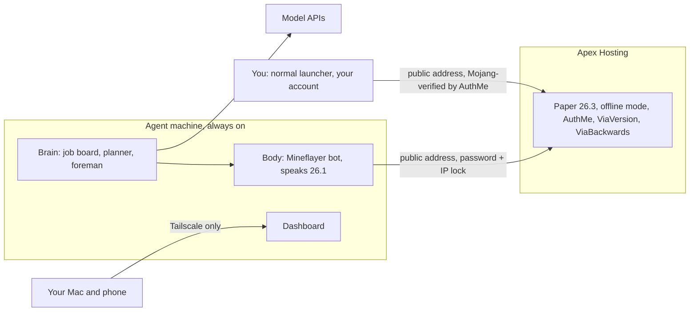

# Cloud Deployment: World on Apex, Agents on an Always-On Machine

Goals: agents run for days without your Mac, play in your Apex Hosting world on the newest Paper (26.3), and still never need a second Minecraft account.

This replaces the "real world on your Mac" part of `03-deployment-strategy.md`. The local Docker server from that doc stays as the lab world.

Facts checked October 21, 2026:

| Thing | Latest | Notes |
|---|---|---|
| Paper | 26.3 (build 209) | Apex offers it in the Game File menu |
| Mineflayer | 4.39.0 | Still stops at 26.1, so the translator is still needed |
| ViaVersion / ViaBackwards | 5.12.1 | Paper 1.10 to 26.3 |
| AuthMe Reloaded | 6.0.1 | Built-in "premium" login that checks real accounts with Mojang |
| PacketEvents | 2.14.0 | 26.3 support; AuthMe needs it for premium checks |
| FastLogin | - | Open "network protocol error on 26.3" bug, so we don't use it |

---

## The short story

There are now two machines, and each does one job.

**Apex runs the world.** Your Paper 26.3 server stays where it is. You keep joining it the way you always do.

**A small rented Linux server runs the agents.** The body (the Mineflayer bot), the brain, and the dashboard all live there. It's on 24/7, so a castle can take three days and nobody has to keep a laptop awake. The bot connects to Apex over the internet like any other player.

The hard part is the bot's account. Apex's server normally asks Microsoft "is this a real paid account?" for everyone, and the bot doesn't have one. So we turn that check off (offline mode). That alone would be dangerous, because the server is on the public internet. Anyone could type your name and walk in as you, with your operator powers.

A login plugin called **AuthMe** closes that hole. It works like a bouncer with two rules:

- **Real players** prove who they are with their Microsoft account, checked directly with Mojang. You run `/premium` once and never think about it again.
- **The bot** has a password, and AuthMe only accepts that name from the cloud machine's IP address. Someone who steals the password still can't use it from home.

AuthMe also kicks any name you haven't registered from the console, so it doubles as the whitelist.

The translator plugins (ViaVersion and ViaBackwards) sit on Apex too. They let the bot, which speaks 26.1, play in the 26.3 world.

Your dashboard is never exposed to the internet. The cloud machine joins a private network (Tailscale) with your Mac and phone, and only those devices can open it.

What it costs: roughly **$30 to $90 a month** all in, mostly Apex (which you already pay) and model API usage (which you cap).



---

## What you need to do

### Accounts to create

| Account | Why | Cost |
|---|---|---|
| Apex Hosting | You have it. Check the plan's RAM and location (see below) | What you pay now |
| Hetzner **or** Vultr (pick by Apex location) | The always-on agent machine | About €6 to $20 a month |
| Tailscale (Personal plan; sign in with Google or GitHub) | Private access to the dashboard and SSH | Free (up to 6 users, unlimited devices) |
| Anthropic Console and/or OpenAI Platform | API keys for the planner and foreman models | Prepaid credits; you set the cap |
| GitHub | The agent machine pulls this repo | Free |

No second Minecraft account. No domain name.

### Money

| Item | Monthly | Notes |
|---|---|---|
| Apex server | Current plan, maybe +$5 to $10 | The bot is a second player that loads its own chunks when it roams away from you. On less than 6 GB, expect lag during long trips. Apex lists 4 GB at $14.99, 6 GB at about $20, 8 GB at about $25 |
| Agent machine | €6 (EU) to $20 (US) | 2 vCPUs and 4 GB is comfortable. Hourly billing with a monthly cap on both providers |
| Model APIs | $20 to $50 to start | Both providers are prepaid: buy credits, then the API stops when they run out. Also set a monthly spend limit |
| Tailscale | $0 | |
| **Total** | **about $30 to $90** | |

For scale: the planner and foreman split in `02-how-we-make-it-better.md` is the difference between about $1 and about $93 per dragon run. While developing, loops and bugs are what burn credits, so set the cap before you hand out a key. Turn off auto-reload (OpenAI enables it by default when you first buy credits).

### Steps, in order

1. **Find your Apex location.** It's shown in the panel and in the server address. Note your plan's RAM.
2. **Back up the world.** Apex panel, then Backups, then create one and download it. Offline mode changes how player data is keyed (see "Your player data" below).
3. **Create the accounts above.** Model providers: buy $20 of credits, set a monthly limit, turn off auto-reload, and create one API key named `minegent`.
4. **Make an SSH key on your Mac** if you don't have one: `ssh-keygen -t ed25519`. Upload `~/.ssh/id_ed25519.pub` to the provider.
5. **Create the agent machine** (see "Picking the machine"): Ubuntu 24.04 LTS or newer, your SSH key, and paste `infra/cloud/cloud-init.yaml` into the "user data" / "cloud-init" box. Write down its public IPv4 address.
6. **Lock the machine down** (see "After first boot").
7. **Set up Apex** (see "The Apex changes"). You'll need the IPv4 address from step 5.
8. **Hand off to Phase 1.** On the machine, `git clone` this repo into `/opt/minegent`, then copy `infra/cloud/.env.example` to `/opt/minegent/.env` and fill it in. The hello bot from Phase 1 runs here.

---

## Zoom in: picking the machine

Put it in or near the same city as your Apex server. The bot reacts to every block update, so a short trip between the two machines matters more than raw speed.

| Apex location | Agent machine | Price |
|---|---|---|
| Amsterdam, Frankfurt, London | Hetzner CX23 (2 vCPU, 4 GB), Nuremberg or Falkenstein | €5.99 a month with IPv4 |
| New York, Vint Hill, Miami, Dallas, San José | Vultr Regular Performance (2 vCPU, 4 GB) in the nearest city | $20 a month |
| Elsewhere | Vultr in the nearest city | Similar |

Notes:
- Hetzner's US servers got much more expensive in June 2026. For a US Apex server, Vultr is the better deal now.
- Hetzner CX23 is sometimes sold out. CAX11 (ARM, same size, €5.99 plus IPv4) works just as well, since Node, Docker, and Mineflayer all run on ARM.
- You need a public IPv4 address (not IPv6 only). AuthMe locks the bot to it.
- Skip paid provider backups. What matters (the job board and notebook) is one small SQLite file, and we can copy it off nightly.

## Zoom in: after first boot

`infra/cloud/cloud-init.yaml` runs once on first boot. It:
- creates a `minegent` user that uses your SSH key, then turns off root and password logins
- installs Docker, Docker Compose, git, sqlite3, and Tailscale
- adds 2 GB of swap, so a memory spike slows things down instead of killing the bot
- caps Docker log size, so week-long runs don't fill the disk
- turns on a firewall that blocks everything incoming except SSH and Tailscale

Give it a few minutes after the machine shows "running," then:

```bash
ssh minegent@<public-ip>
sudo tailscale up --ssh          # opens a login link; approve it
```

Install Tailscale on your Mac (and phone if you want), signed into the same account. Check that `ssh minegent@<machine-name>` works over Tailscale, then close public SSH completely:

```bash
sudo ufw delete allow OpenSSH
```

From now on the machine accepts no connections from the internet at all. It only makes outgoing ones, to Apex, the model APIs, and GitHub.

One trap for later: Docker publishes ports around the firewall. When the dashboard gets a compose file, bind its port to the Tailscale address or `127.0.0.1`, never to plain `8080:8080`.

## Zoom in: the Apex changes

Do these with the server stopped, in this order.

**1. Upload plugins** through FTP File Access into `plugins/`. The built-in Plugin List searches Bukkit and Spigot, and these are best taken straight from their official pages:
- ViaVersion 5.12.1 and ViaBackwards 5.12.1 ([Hangar](https://hangar.papermc.io/ViaVersion/ViaBackwards))
- PacketEvents 2.14.0, Spigot build ([Modrinth](https://modrinth.com/plugin/packetevents))
- AuthMe Reloaded 6.0.1, **the Paper jar** (it now ships one jar per platform) ([GitHub releases](https://github.com/AuthMe/AuthMeReloaded/releases))

**2. Start once, then stop.** That makes AuthMe write `plugins/AuthMe/config.yml`.

**3. Edit `plugins/AuthMe/config.yml`.** Only these keys change:

```yaml
settings:
  restrictions:
    # Nobody can register in-game. Accounts are created from the console,
    # so this is also the whitelist.
    kickNonRegistered: true
    AllowRestrictedUser: true
    AllowedRestrictedUser:
      - Builder;203.0.113.7        # your agent machine's public IPv4
  registration:
    dialog:
      # Mineflayer can't answer login dialogs; it types /login in chat instead.
      preJoin:
        enable: false
      postJoin:
        enable: false
  enablePremium: true
```

**4. Turn on offline mode.** Config Files, then Server Settings, then set Online Mode to Disabled. Leave the vanilla whitelist off; AuthMe replaces it.

**5. Start the server and register both accounts from the console:**

```
authme register <your name> <your password>
authme register Builder <long random password>
```

Join with your normal launcher, `/login <your password>`, then run `/premium` and rejoin. From then on Mojang vouches for you and there's no password prompt. Run `op <your name>` from the console if you lost operator status (see the next section). **Never op the bot.**

**6. Test the lock.** From your Mac, try joining as `Builder` with an offline launcher. AuthMe should kick you, because your IP isn't the machine's.

### Your player data

Minecraft files each player's inventory, ender chest, position, and operator status under an ID. In online mode, that ID comes from your Microsoft account. In offline mode, it's calculated from your name. After the switch, you may join as a "new" player with an empty inventory. Your old data isn't gone; it's just filed under the old ID.

If that happens:
1. Stop the server.
2. In `usercache.json` (from before the switch, or from your backup), find your old online ID. In `world/playerdata/`, find the new file created when you first joined offline.
3. Copy `<old-id>.dat` over `<new-id>.dat`. Do the same in `world/stats/` and `world/advancements/` (`.json` files).
4. Start the server and op yourself again from the console.

If AuthMe's premium mode turns out to keep your Microsoft ID, none of this is needed. Check `world/playerdata/` after your first offline join and you'll know. Plugins that store data by player ID (land claims, economy) may need the same treatment. Apex's own offline-mode guide covers this.

### Apex restarts

Many Apex servers restart on a schedule, and Apex itself occasionally restarts for maintenance. The bot has to treat a disconnect as normal: wait, reconnect, `/login`, and resume from the job board. That reconnect loop is a Phase 1 requirement, not a nice-to-have.

## Zoom in: how the bot connects

Same as `03-deployment-strategy.md`, but reading the address from `.env` and logging in after it spawns:

```ts
const bot = mineflayer.createBot({
  host: process.env.MC_HOST,
  port: Number(process.env.MC_PORT),
  username: process.env.BOT_USERNAME,
  auth: 'offline',
  version: process.env.MC_VERSION
})

bot.once('spawn', () => bot.chat(`/login ${process.env.BOT_PASSWORD}`))
```

## Zoom in: running for days

What keeps a long mission alive, from the bottom up:

| Layer | What happens if it stops | What brings it back |
|---|---|---|
| Agent machine | Provider maintenance reboot | Docker's `restart: unless-stopped` starts the agents at boot |
| Agent process | Crash or out of memory | Same restart policy; swap makes out-of-memory rare |
| Bot connection | Apex restart, network blip, kick | Reconnect loop with backoff, then `/login` |
| The mission | Any of the above | Job board on disk: re-check the active job's finish line and continue |
| Spending | A loop burning model calls | Provider spend limit stops it hard |

The job board and notebook live in a SQLite file under `/opt/minegent`. Copy it off nightly (a cron job with `sqlite3 .backup`), and before every Paper or plugin update.

## When Minecraft updates

Same routine as `03-deployment-strategy.md`, but on Apex:
1. Wait for ViaBackwards, PacketEvents, and AuthMe to support the new version. If AuthMe or PacketEvents lags, **don't update**. Without them, offline mode is unprotected.
2. Back up through the Apex panel.
3. Change the version in the Game File menu, replace the plugin jars, restart.
4. Run the lab's quick check before resuming real missions.

## If the login plugins ever break

The fallback is the one we've avoided so far: buy a second Java account for the bot, switch the server back to online mode, and remove AuthMe and PacketEvents. It's the simplest secure setup. It just costs one account.

## Safety checklist

- Online mode is off **only** while AuthMe (premium mode on) and PacketEvents are installed and loading without errors. Check the console after every restart.
- `kickNonRegistered` is on, so only accounts you registered from the console can join.
- `Builder` is IP-locked to the agent machine and has a long random password.
- The bot isn't operator.
- The agent machine accepts no incoming internet connections once Tailscale works.
- API keys live only in `/opt/minegent/.env`, which git ignores.
- A monthly spend limit is set at every model provider, and auto-reload is off.

---

## Sources

- Paper downloads: [papermc.io](https://papermc.io/downloads/paper)
- Apex: [offline mode guide](https://apexminecrafthosting.com/guides/general/how-to-make-an-offline-minecraft-server/), [plugins and Paper setup](https://apexminecrafthosting.com/guides/general/how-to-make-a-minecraft-smp-server/), [locations and hardware](https://apexminecrafthosting.com/server-specs/)
- Mineflayer versions: [README](https://cdn.jsdelivr.net/npm/mineflayer@4.39.0/docs/README.md), [26.x issue](https://github.com/PrismarineJS/mineflayer/issues/3893)
- ViaBackwards 5.12.1: [Hangar](https://hangar.papermc.io/ViaVersion/ViaBackwards/versions/5.12.1)
- AuthMe: [releases](https://github.com/AuthMe/AuthMeReloaded/releases), [config reference](https://github.com/AuthMe/AuthMeReloaded/blob/master/docs/config.md)
- PacketEvents 2.14.0: [release notes](https://packetevents.com/blog/release-2-14-0/)
- FastLogin 26.3 bug: [issues](https://github.com/TuxCoding/FastLogin/issues)
- Hetzner prices after June 15, 2026: [price adjustment](https://docs.hetzner.com/general/infrastructure-and-availability/price-adjustment/)
- Vultr prices: [vultr.com/pricing](https://www.vultr.com/pricing/)
- Tailscale Personal plan: [pricing](https://tailscale.com/pricing)
- Model billing: [Anthropic](https://support.claude.com/en/articles/8977456-how-do-i-pay-for-my-claude-api-usage), [OpenAI prepaid](https://help.openai.com/en/articles/8264644-setting-up-and-managing-prepaid-api-billing), [OpenAI spend limits](https://developers.openai.com/api/docs/guides/spend-limits)
