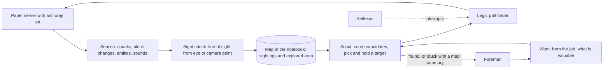

# Perception and Exploration

Written October 24, 2026. This covers what the bot can actually see, how much of that it should be allowed to use, and how it decides where to go next while it moves. It extends section 1 (the body) and section 5 (the notebook) of `02-how-we-make-it-better.md`.

Facts checked October 24, 2026 against the Mineflayer API docs and source, the Paper configuration reference, the Minecraft Wiki, and Mine AI MCP's source.

---

## The short story

A Mineflayer bot has no eyes. It doesn't render anything, so "first person" and "third person" don't mean anything to it. What it gets instead is the same data the server sends a real player's game before the game draws the picture: every block in every chunk around it, all the way from bedrock to the sky, plus every nearby mob and player.

So the bot doesn't see *too little*. It sees too much. Out of the box it knows where every diamond is within 160 blocks, through solid stone. That is x-ray, and this project's rule is that the bot plays fair.

So the job is to take something that knows everything nearby and make it act on only what a player could have seen. We do that two ways:

1. **The server hides ores and chests.** Paper has a built-in anti-xray setting. With it on, ores buried in stone are sent as plain stone. The bot can't cheat with data it never receives. This matches how we stop it using `/give`: the server enforces it, not a prompt.
2. **The bot only goes toward things it could see.** Before something can become a destination, the bot checks that there is a clear line from its eyes to it. Looking around in a full circle is allowed, because a player can turn the camera. Climbing a hill or a tree to look further is allowed too, because a player would do that.

Your third-person idea fits here, just in a different form. A third-person camera sits a few blocks behind and above the player's head, so it can peek over a low wall. For the bot, that's just a different starting point for its sight lines. The bigger win is the same thing a player does when lost: get up high and look around.

Then the loop. While the bot walks, new chunks keep arriving and the bot keeps checking what it can see. Everything it spots goes onto a map in the notebook. A small piece of plain code, the **scout**, keeps asking "given what I'm looking for and everything on the map, what's the best place to head right now?" It weighs how useful each place is against how far away and how dangerous it is. If nothing on the map is worth it, it heads for the edge of the explored area that looks most promising, or climbs up to look further.

It doesn't change its mind every step. It only switches targets when something clearly better turns up, the current target disappears, it arrives, or it gets stuck. If it runs out of good options, it stops and reports a short summary to the foreman ("covered 40 chunks, no exposed iron, two cave openings to the east, mountain to the north"), and the model decides the strategy.

The model never sits inside this loop. It sets what we want ("iron ore", "a village", "blazes"), and the scout does the looking and walking at code speed.

---

## How the pieces fit



---

## Zoom in

### 1. What the bot actually receives

| Sense | Range | Notes |
|---|---|---|
| Blocks | A square of chunks around the bot: the server's `view-distance` (default 10) or the client's request (Mineflayer's default `far` is 12), whichever is smaller. So 10 chunks, about 160 blocks in each direction, full height | Arrives as whole chunk columns. Mineflayer fires `chunkColumnLoad` as each one arrives and `blockUpdate` whenever a block changes |
| Mobs and players | Paper defaults: players 128 blocks, animals and monsters 96, also limited by view distance | `entitySpawn`, `entityMoved`, `entityGone`. Includes mobs behind walls |
| Sounds | Whatever the server sends to a player at that spot | `soundEffectHeard` with position. Useful as a fair hint ("zombie groaning below") |
| Its own state | Always | Health, food, position, inventory |

Mineflayer has helpers built on this data: `bot.findBlocks` searches loaded chunks for matching blocks (default radius 16), `bot.canSeeBlock` checks line of sight to one block, and `bot.blockAtCursor` raycasts along the current look direction.

The bot also doesn't need to face something to know about it. So "field of view" in the human sense is a rule we choose, not a limit we're stuck with.

**What Mine AI MCP does today:** its frontier recorder (`src/runtime/frontier.ts`) scans each loaded chunk column and stores the materials found in it, buried ores included. It's honest about what the data contains, but it's not limited to what a player could see. Their `line-of-sight.ts` exists for choosing where to dig from, not for limiting perception. We inherit both and add the fairness layer on top.

### 2. Fair sight: the rule

**What the bot may use to choose a destination:** only things it has seen. Something is seen if a ray from a viewpoint reaches it without hitting a solid block, within render distance. Fluids and see-through blocks don't stop rays, which is how Prismarine's raycast already behaves.

**What the legs may use to plan a route:** full terrain data. The pathfinder needs block shapes to walk, and a player can see the ground they're walking on anyway. The leak here is small. The big cheat is choosing *where to go* based on hidden things, and that's what the rule blocks.

**Allowed viewpoints:**

- The eye, turned in any direction. A full circle is fair because a player can spin the camera.
- A camera point raised and pulled back from the head, like third-person view (about 4 blocks behind in vanilla). Fair, because players use it to peek over walls.
- Any spot the bot actually walks or climbs to. A "go up and look" move is a normal choice the scout can make.

**What is exempt:** reflexes may react to any mob in the entity list, including one behind a wall. A player would hear it, and keeping the bot alive matters more than purity here. Reflexes protect; they don't pick destinations.

**Why two layers.** Anti-xray guarantees the most valuable cheat (ores and chests in solid stone) can't happen, even if our code has a bug. The sight check covers the rest, like spotting a cave, a structure, or a lava pool behind a hill. Neither alone is enough: anti-xray doesn't hide caves or buildings, and a code-only rule can be broken by one careless `findBlocks` call.

### 3. How to check sight cheaply

The obvious approach is to cast a ray for every direction, like a camera. At render distance that's tens of thousands of rays per look, each crossing up to a few hundred blocks. It's too slow to repeat while walking, and most of that work tells us nothing.

The better approach: **sight is a filter on facts, not a camera.** We only ask "could I see this?" about things that matter.

- **Things of interest.** When a chunk arrives, find the blocks the current job might care about (ores, logs, water, lava, chests, structure blocks). Drop any that aren't touching air or water on some face, since nobody can see a block that's fully buried. For the rest, cast one ray from the viewpoint. That's a few hundred rays, not tens of thousands.
- **Explored area.** For each chunk, take a handful of surface points from the top of each column and cast a ray to each. A chunk counts as looked at when enough of them are visible. This is what tells the scout where the edge of the known world is.
- **Spread the work.** Run checks a few hundred per tick from a queue, and re-check only when the viewpoint moved a few blocks or a block changed. A cell that has been seen stays seen.

### 4. The map: what the notebook remembers

Two kinds of memory, because things change at different speeds.

**Sightings.** Each entry has the kind (`iron_ore`, `cave_opening`, `village_bell`, `zombie`), the position, when it was seen, and where it was seen from. Blocks stay valid until a `blockUpdate` or a chunk reload shows they changed. Mobs expire within seconds of leaving sight, because they move. Dropped items expire after five minutes, because that's when they despawn.

**Explored area.** Per chunk: whether it has been looked at, when, and a few cheap summaries (biome, how much of the surface is water, how much exposed stone). This extends Mine AI MCP's `frontier_chunks` table. The change is that "explored" means *seen*, not just *loaded*.

Everything persists in SQLite, so a restart or death doesn't throw the map away.

### 5. The want: what the job is looking for

The scout is goal-agnostic. The job hands it a **want**, which is a small description of what's valuable:

```ts
interface Want {
  targets: Array<{ kind: string; value: number }>
  hints: Array<{ kind: string; value: number }>
  avoid: Array<{ kind: string; penalty: number }>
  budget: { minutes: number; maxDistance: number }
}
```

- `targets` are what finishes the search: `iron_ore` for "get iron", `blaze` for "get blaze rods".
- `hints` are things that tend to lead to targets: cave openings and exposed stone for iron, nether bricks for a fortress, a bell or farmland for a village.
- `avoid` makes some places cost more: lava, deep water, groups of hostile mobs, protected zones.

Playbooks supply the want for common jobs. When the foreman improvises, it writes one. Either way, it's data, so it can be tested in the lab and tuned without touching the scout.

### 6. The scout: picking where to go

Each time the scout re-thinks, it gathers candidates from three places:

1. **Sightings** that match a target or a hint.
2. **Frontier spots:** reachable places on the edge of the explored area.
3. **Vantage points:** nearby high spots (a hilltop, a tree, or a short pillar) where looking around would reveal a lot of unexplored area.

Each candidate gets a score:

> score = value × confidence ÷ (travel cost + work cost) − risk

- **Value** comes from the want. For a frontier spot, it's the expected new area times how promising that direction looks (biome, nearby hints). For a vantage point, it's the expected new area visible from up there.
- **Confidence** drops as a sighting gets old.
- **Travel cost** is the pathfinder's cost estimate, not straight-line distance. A diamond across a ravine isn't close.
- **Work cost** is the time to mine, fight, or climb once there.
- **Risk** comes from `avoid` and the bot's state. Low health makes dangerous places much more expensive.

It picks the best and hands it to the legs.

### 7. When to change its mind

A scout that re-picks every tick zig-zags between two similar targets and never arrives. A scout that never re-picks walks past a diamond to reach a frontier edge. So it holds a target and only re-thinks on these triggers:

| Trigger | Why |
|---|---|
| A new sighting matches a target or hint | The best option may have changed |
| The current target became invalid (block mined, mob left, area unsafe) | Nothing left to go toward |
| Arrived | Pick the next thing |
| The path failed or progress stalled | The cost estimate was wrong |
| A reflex finished | The bot may be somewhere else, or hurt |
| A slow timer, every couple of seconds | Costs change as the bot moves |

On a re-think it switches only if the new best beats the current target by a clear margin, around 25%, or the current target is gone. That margin is what stops zig-zagging.

### 8. When to stop and ask

The scout returns to the foreman with a receipt in three cases:

- **Found:** a target is reached, with its position and how it was seen.
- **Exhausted:** the budget ran out, or no candidate scores above a minimum.
- **Blocked:** something it can't handle, such as needing to cross an ocean or not being able to reach the only target.

Exhausted and blocked receipts include a short map summary built from the notebook: area covered, best hints seen and where, biomes around, hazards. That's the briefing the foreman or planner needs to make the strategic call, such as "strip-mine at y=16 instead" or "buy a map from a cartographer", without reading the history.

### 9. Where it lives in the code

- **Body (`packages/body`):** senses, the sight check, and one new action, `seek(want)`. It's a long-running action like `navigate`, built on the same background action system, and it can resume after a reflex interrupts it. The sense, score, and move loop runs inside it.
- **Notebook (`packages/notebook`):** the sightings table and the "seen" columns on the explored-area table.
- **Brain (`packages/brain`):** wants live in playbooks, and the foreman builds them when improvising. The brain only sees `seek`'s receipts.
- **Server (`infra`):** anti-xray turned on in `paper-world-defaults.yml` with engine mode 1, which replaces hidden ores with stone. Mode 2 also adds fake ores; skip it, because those would fill the sightings table with ores that don't exist.

### 10. Why this shape

| Choice | Instead of | Why |
|---|---|---|
| Server-side anti-xray | Trusting our own code | The bot can't use data it never received. Same principle as never giving it operator rights |
| Sight as a filter on facts | Casting rays like a camera | A few hundred rays instead of tens of thousands, and it only checks things that change a decision |
| Full terrain for routes, seen facts for destinations | Hiding unseen terrain from the pathfinder too | That would break walking for very little fairness gain. The cheat that matters is choosing destinations from hidden data |
| Plain code in the loop | The model choosing each step | Re-thinking every couple of seconds over hundreds of candidates is cheap in code and slow and costly through a model. The same split let Astra + Jev finish with 35 planner calls |
| Wants as data | One search routine per goal | One scout serves every job. Wants can be tested and tuned in the lab |
| Re-think on triggers, with a switching margin | Re-think every tick | No zig-zagging, and no walking past something obviously better |
| Map in SQLite | Map in memory | Survives deaths and restarts, and feeds the short briefings |

### 11. How to test it

The lab method in `04-testing-dialogue.md` applies directly.

- **Fair against omniscient.** Run the same "find iron" scenario with sight checks on and off on the same seeds. The gap shows what fairness costs us. If the fair version is much worse, improve its hints and vantage use. Don't loosen the rule.
- **Search efficiency.** Record blocks walked and minutes taken before the target was found, and how often the scout switched targets. Lots of switches with little progress means the margin is too small.
- **A leak check.** Before trusting a run, verify that every target it went to has a sighting with a viewpoint and a clear ray. Any target without one is an automatic failure flag.

---

## Open questions

- **Sight check cost on real chunks.** The numbers above are estimates. Measure rays per second on the 26.3 server through ViaBackwards before tuning the batch sizes.
- **How far a camera point can go.** Start with eye height plus a third-person offset. If players commonly use mods that zoom out further, that isn't a reason to allow it.
- **Sounds.** `soundEffectHeard` is a fair sense and a good hint for caves and mobs. Decide during Phase 3 whether hints should include sounds.

---

## Sources

- Mineflayer API, including `findBlocks`, `canSeeBlock`, `blockAtCursor`, `chunkColumnLoad`, `soundEffectHeard`, and `settings.viewDistance`: [docs/api.md](https://github.com/PrismarineJS/mineflayer/blob/master/docs/api.md)
- Mineflayer view distance presets (`far` = 12 chunks): [lib/plugins/settings.js](https://github.com/PrismarineJS/mineflayer/blob/master/lib/plugins/settings.js)
- Server `view-distance`, `simulation-distance`, and `entity-broadcast-range-percentage`: [Minecraft Wiki, server.properties](https://minecraft.wiki/w/Server.properties)
- Paper entity tracking ranges: [Spigot configuration reference](https://docs.papermc.io/paper/reference/spigot-configuration/)
- Paper anti-xray (off by default, engine modes): [world configuration reference](https://docs.papermc.io/paper/reference/world-configuration/), [anti-xray guide](https://docs.papermc.io/paper/anti-xray/)
- Mine AI MCP frontier and line of sight: [src/runtime/frontier.ts](https://github.com/aibengineering/mine-ai-mcp/blob/main/src/runtime/frontier.ts), [src/navigation/world/line-of-sight.ts](https://github.com/aibengineering/mine-ai-mcp/blob/main/src/navigation/world/line-of-sight.ts), [docs/mcp/concepts.md](https://github.com/aibengineering/mine-ai-mcp/blob/main/docs/mcp/concepts.md)
